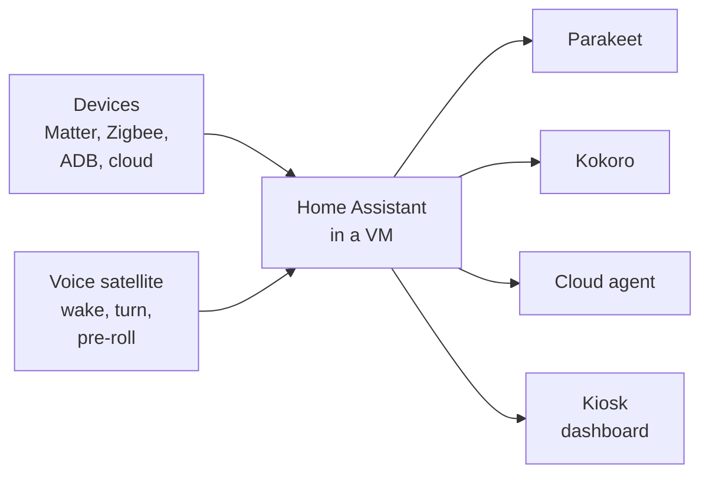
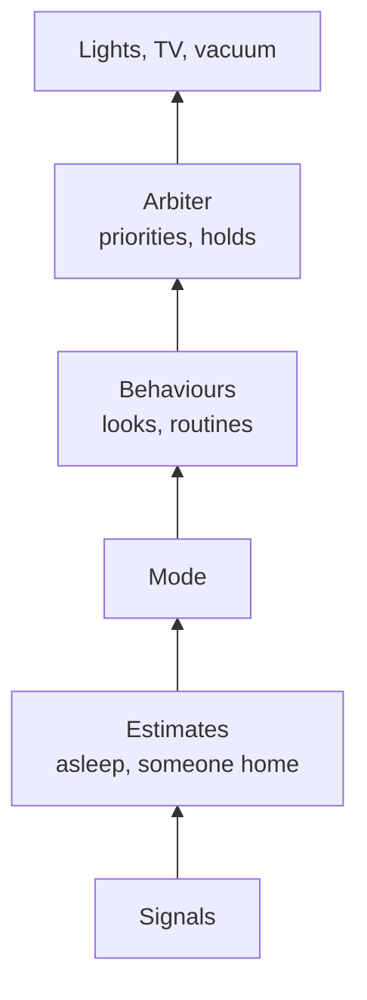

<div align="center">

# Foster's Home Hub

A retired Teams Rooms console on the counter, running a whole house: touchscreen, ears, voice, and a
control system behind them. Set up the way I set up mine, for anyone with the same box.


</div>

---

The Lenovo ThinkSmart Hub 500 was built to sit on a conference table and run Microsoft Teams, and
under the plastic it's a quad-core i5 mini PC with a 1080p touchscreen, a two-mic array and a pair of
decent speakers in one box. Lenovo stopped supporting it in October 2025, which is how it got cheap
enough to leave on a counter as the house's brain, which is what I did with mine. This repo is
that work made generic, so friends with the same box can set theirs up the same way and go from
there: the scripts that build the Debian host, the Home Assistant config that runs in a VM on it,
the voice satellite and its speech engines, the tests, and the write-ups, with every bit of my own
house taken out and replaced by one file that's yours.

I'm a controls engineer by day, so the house is built the way I'd build a machine at work: estimate
the state properly, settle arguments between automations with priorities, test against a clock, and
keep working with a part missing. The docs go into that as deep as it goes, math included, and you
can skip all of it and still have a house that works.

What's measured and what isn't: the numbers in here came off my Hub, mostly with my own voice and my
own nights, so they're one box and one person rather than a benchmark. Everything runs and is tested
on mine. I haven't yet watched someone else build theirs from these steps, so the first few friends
through [the setup](docs/setup.md) are also finding out where it's unclear, and an issue saying so
is the most useful thing anyone could send.

## What you get

- A touchscreen dashboard, made from your rooms and lights, with the house's modes a tap away
- "Hey Jarvis" on the Hub itself, with no chimes and no waiting: local wake word, echo cancelling,
  an end-of-turn model that hears when a sentence is finished, local speech to text and a local
  voice, and a cloud agent of your choice behind Home Assistant's own sentences. About 2.6 s from the
  last word to the first sound on mine
- Lights by layer, following a light curve through the day and blending changes in too slowly to
  see, with a hand at the switch always winning for three hours
- Modes and routines (morning, evening, calm, movie night, goodnight, leaving, arriving) that run
  themselves and stop when you tell them to
- Presence from the phone and the front door together, so a phone left somewhere doesn't make the
  house think it's empty, and a guest left behind doesn't get plunged into darkness
- A welcome home that never says the same thing twice: a digest on the Hub reads the newsletters,
  repos and forums you pick and hands Jarvis something new each time, told a different way
- A wake-up that does a sunrise, then won't give up until you're up, with a backstop that shares
  nothing with it
- Optional parts for a Fire TV, a robot vacuum, a doorbell, a Windows computer, Klipper and Bambu
  printers, an LG washer, a work calendar and an Oura ring, each sitting quietly until you have one
- Scenario tests on the real Home Assistant with a frozen clock, run before every deploy

## What you need

A Hub 500, an Ethernet cable to your router (Wi-Fi can't be bridged), a USB stick, and a computer
with `bash`, `ssh`, `git` and Python 3.11 or newer. 16 GB of RAM in the Hub is worth the cost, and
a phone with the Home Assistant app makes presence work. Everything else is optional.

## How it fits together



Inside Home Assistant the logic is a control stack, each layer reading the one under it and never
redoing its job:



Your house goes in `house.toml`, which never leaves your computer. The deploy renames your devices
onto a set of standard names the packages read, labels your lights by layer and job, and builds the
dashboard from your rooms, so the packages themselves never change from house to house.

## Where to start

Levels as in my handbook: 1 is no math, 4 is in the weeds.

| If you want... | Read | Level |
|---|---|---|
| To set one up, step by step | [docs/setup.md](docs/setup.md) | 1 |
| What the house expects of your devices, and the names it uses | [docs/devices.md](docs/devices.md) | 1 |
| What stays home, where the secrets live, and what to check before pushing a fork | [docs/privacy.md](docs/privacy.md) | 1 |
| What runs where, and what survives a failure | [docs/architecture.md](docs/architecture.md) | 2 |
| How the voice went from 5.5 s to 2.6 s, with the models, the math and the bugs | [docs/voice.md](docs/voice.md) | 4 |
| The control system: the asleep filter, occupancy, PID, priorities and holds | [docs/control.md](docs/control.md) | 3 to 4 |
| Every signal the house has and how far to trust it | [docs/sensing.md](docs/sensing.md) | 2 to 3 |
| Modes, looks, leaving and arriving, the wake-up | [docs/routines.md](docs/routines.md) | 2 to 3 |
| Lights by layer, the curve they follow through the day, and how to add one | [docs/lighting.md](docs/lighting.md) | 3 |
| ESP32 sensor nodes to build, and why they beat buying | [docs/esp32.md](docs/esp32.md) | 2 |
| The scenario tests and the bench they run on | [docs/testing.md](docs/testing.md) | 2 to 3 |
| What broke along the way, and why | [docs/lessons.md](docs/lessons.md) | 1 to 2 |
| The hardware, measured | [docs/hardware.md](docs/hardware.md) | 1 to 2 |
| Which addresses to reserve, and a layout to borrow | [docs/network.md](docs/network.md) | 1 |

## What's in here

```text
house.example.toml  your house, as an example: copy it to house.toml (never committed) and fill it in
host/               scripts that build the Debian host, run in order (tools/push.sh runs them)
  00-base.sh          updates and base tools
  10-virt.sh          KVM, libvirt, UEFI firmware for the VM
  20-bridge.sh        br0 on the Ethernet port
  21-wifi-off.sh      Wi-Fi off once br0 works
  22-mdns-name.sh     wins ha-hub.local back if avahi renames itself after a conflict
  30-haos-vm.sh       downloads, checks and creates the Home Assistant OS VM
  40-kiosk.sh         the dashboard on the touchscreen with a touch keyboard, and its watchdog
  50-screen.sh        hub-screen: panel power and brightness, PIR, touch wake, over MQTT
  55-stats.sh         hub-stats: CPU, memory, temperatures and disk, per part
  58-digest.sh        hub-digest: what the welcome home talks about, fenced to the VM
  60-audio.sh         PipeWire with WebRTC echo cancelling, hub_speaker and hub_mic as defaults
  70-voice.sh         Linux Voice Assistant, pinned, no chimes, Smart Turn and its models
  patches/            the satellite's changes: follow-up window, player, wake log, end of turn, pre-roll
  72-ring.sh          hub-ring: the LED ring as the status light
  74-kokoro.sh        kokoro-wyoming: Jarvis's voice, fenced to the VM
  76-parakeet.sh      parakeet-wyoming: Jarvis's ears, fenced to the VM
  78-esphome.sh       ESPHome, for building the ESP32 nodes on the Hub
  79-android.sh       the JDK, Android's packaging tools and R8, for building the TV keeper
  80-ollama.sh, 81-ollama-fence.sh   an optional local model
  90-test-env.sh      the test bench: Home Assistant 2026.10.0 on its own Python 3.14
hub/                code that runs on the Hub: the three services, the speech engines' Wyoming
                    servers, Smart Turn for the satellite, the house words for speech to text, and
                    the digest with its example sources (digest.example.toml)
ha/
  config/             copied into /config: packages (one file per feature), custom sentences,
                      custom_templates (control.jinja, estimates.jinja, lighting.jinja)
  context/            about.md, the agent's prompt, and an example for your about.local.md
  automations/        one JSON file each
  dashboards/parts/   the fixed parts of the dashboard tools/dashboard.py builds
esphome/            the ESP32 sensor nodes, one YAML each, and common/ with the parts they share
tests/              scenario tests on the real Home Assistant with a frozen clock
tools/              run from your computer
  ha-apps.sh          the deploy: checks house.toml, runs the tests, then setup_ha.py
  setup_ha.py         every Home Assistant step, from house.toml
  house.py            reads and checks house.toml
  dashboard.py        builds the dashboard from your rooms and lights
  ha.py               REST, WebSocket and Supervisor calls (the token lives in ~/.config/ha-hub/token)
  push.sh             copies host/ and hub/ to the Hub and runs host scripts there
  test.sh             the scenario tests on the bench
  ha-extras.sh        community pieces, pinned by version and sha256
  esphome.sh          the ESP32 nodes: check, build, flash, update, logs
  tv.py               the Fire TV through Home Assistant's ADB: a debloat applied, checked, restored
  tv-keeper.sh        builds the TV keeper app on the Hub
  privacy_check.py    looks for your house in your repo before you push it
pc/                 HASS.Agent's sensors and commands for a Windows computer
tv/                 the Fire TV: an example debloat list, and the keeper app that keeps ADB on
probe/              the hardware probe and audio test behind docs/hardware.md
docs/               the write-ups, and figures/ with the script that draws every chart from data.json
```

## Status

Everything here runs on my Hub, and the 85 scenario tests pass on it. The parts I can't vouch for
yet are the ones that depend on your devices being like mine: the optional modules are tested with
the hardware [devices.md](docs/devices.md) lists, and anything else is a reasonable guess with the
names it expects written down. One person living alone is the design point; two residents would need
real changes, which the same page says where to start on.

## License

MIT, see [`LICENSE`](LICENSE): use it, change it, keep the notice. Your `house.toml` and
`about.local.md` are yours and stay out of it.

## Credits

- [jethac/thinksmart-hub-hal](https://github.com/jethac/thinksmart-hub-hal) mapped most of the
  weird hardware on Debian 13 before I got there
- [Radeon24/lnxlink-thinksmart-hub-500](https://github.com/Radeon24/lnxlink-thinksmart-hub-500)
  for the LED ring, brightness and presence entities
- The folks in the [Home Assistant community thread](https://community.home-assistant.io/t/lenovo-thinksmart-hub-500/916239)
  who figured out why HAOS has no touch on this box
- [Home Assistant](https://www.home-assistant.io/) and the Open Home Foundation's
  [Linux Voice Assistant](https://github.com/OHF-Voice/linux-voice-assistant)
- [Smart Turn](https://github.com/pipecat-ai/smart-turn), [Silero VAD](https://github.com/snakers4/silero-vad),
  [sherpa-onnx](https://github.com/k2-fsa/sherpa-onnx) and NVIDIA's Parakeet, Kokoro, and
  microWakeWord and openWakeWord, which do the actual listening and talking

## Related

- [Foster's Extruded Thoughts](https://github.com/SettlingAbyss96/fosters-extruded-thoughts), the
  3D printing handbook the "levels" above come from
- [kalico-filament-buffer](https://github.com/SettlingAbyss96/kalico-filament-buffer), a Kalico
  plugin for a filament buffer, another thing I built in my spare time

Spotted something wrong, or running one of these boxes yourself? Open an issue.
