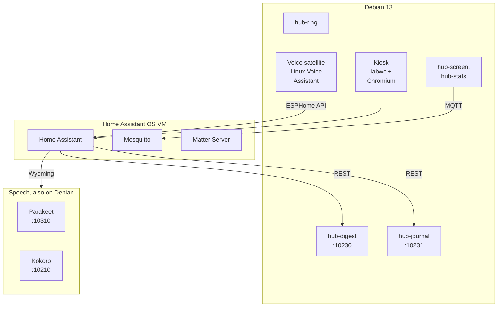
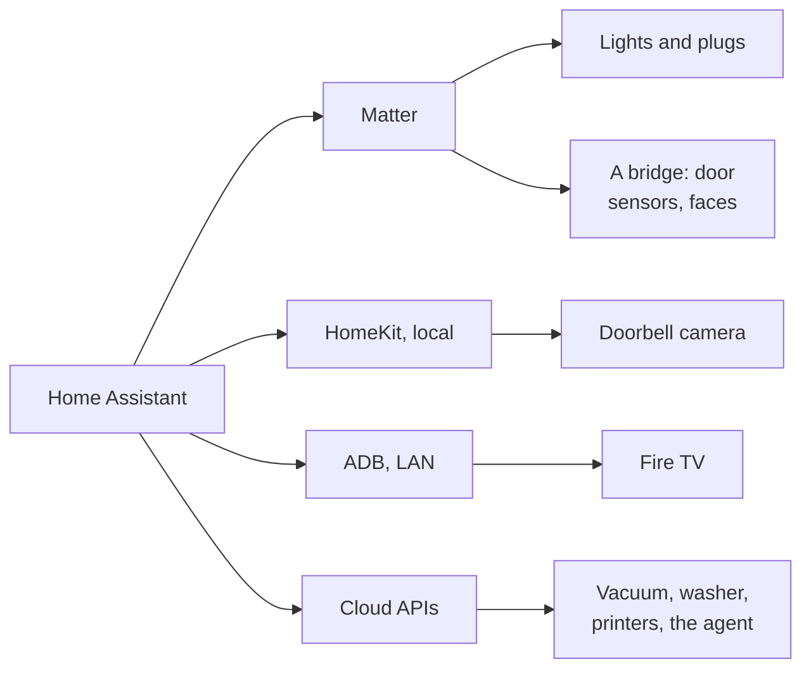
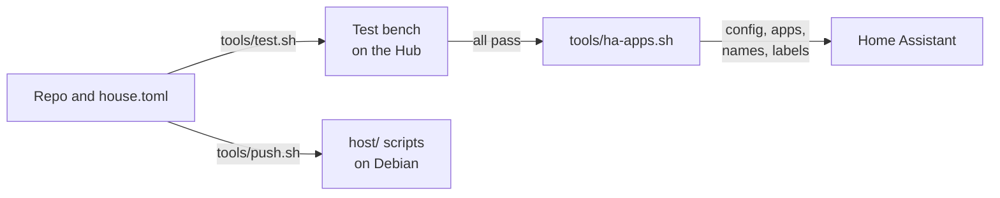

# How it fits together

*Level 2. The one box, what runs where, how devices get in, how a change gets deployed, and what
keeps working when a piece goes down.*

Anyone who's built a machine at work will recognise the shape of this: one controller, a few
processes on it that each own one job, and a clear line between the parts that have to keep running
and the parts that are allowed to fail. Everything runs on one retired conference-room console on
a counter. That was the point and it's also the risk, so most of this page is about where the lines
are drawn inside it: what lives on Debian, what lives in the Home Assistant VM, and which parts can
fail without taking the rest with them.

## Debian on the metal, Home Assistant in a VM

Debian runs on the metal because it's what drives the touchscreen (I2C touch on the stock kernel),
the USB audio and the panel's DDC brightness. Home Assistant OS runs in a VM (3 vCPUs, 3 GB with a fourth held back by the balloon) on a
bridge, `br0`, with its own address, so it keeps its app store and its backups and looks like any
other Home Assistant on the network. The two talk over the LAN like strangers would, which is a
feature: either side can be rebuilt without the other noticing.

The speech engines live on the Debian side because that's where the spare CPU and memory are, and
the digest behind the welcome home and the journal do too, since Home Assistant OS has nowhere to
keep a service of your own running. Each is fenced with nftables so only the VM's MAC (and the Hub itself) can reach
its port.

| Service | Where | Port | What |
|---|---|---|---|
| `linux-voice-assistant` | Hub, user service | 6053 | the satellite: wake word, Smart Turn, pre-roll ([voice.md](voice.md)) |
| `parakeet-wyoming` | Hub | 10310 | speech to text |
| `kokoro-wyoming` | Hub | 10210 | text to speech |
| `hub-digest` | Hub | 10230 | what the welcome home talks about, kept so nothing's said twice ([routines.md](routines.md#what-jarvis-says-when-you-get-in)) |
| `hub-journal` | Hub | 10231 | where you stayed and what kind of place it was, the question after the welcome home, and the answers ([journal.md](journal.md)) |
| `hub-screen`, `hub-stats` | Hub | MQTT | panel power and brightness, the PIR, CPU and temperatures |
| `hub-ring` | Hub | local websocket | the LED ring follows the satellite |
| `ha-kiosk` and its watchdog | Hub | | the dashboard on the touchscreen |
| ESPHome | Hub, a tool, not a service | | builds the ESP32 sensor nodes and updates them over Wi-Fi ([esp32.md](esp32.md)) |
| Home Assistant, Mosquitto, Matter Server | VM | 80, 1883 | the house |

## How devices get in

Local first, cloud where there's no choice. Matter lights and plugs pair from the phone and stay
local. A doorbell that's also a Zigbee hub and a Matter bridge, like the Aqara G410, brings its door
sensors in as plain Matter contact sensors with nothing extra in Home Assistant, and the doorbell
itself comes over HomeKit Controller, local, out of Apple Home. A Fire TV comes over ADB on the LAN
because everything else it offers is worse ([lessons.md](lessons.md)). A Klipper printer is Moonraker
on the LAN, a Windows computer is HASS.Agent, and the phone is the Home Assistant app plus a few
Shortcuts. The cloud ones are cloud because that's the only way in, and nothing time-critical
depends on them.

## How fast each loop runs

The same house runs control loops at very different speeds, and keeping them apart is half of what
makes it manageable. A faster loop never waits on a slower one:

| Time scale | Loop | Decides |
|---|---|---|
| 32 ms | Silero and Smart Turn in the satellite | is this the end of the sentence |
| about 1 s | the gate and the by-hand detector | may this light change, was that a person |
| 1 min | the asleep filter, the occupancy tick, reminders | what's true about the person right now |
| 1 min | the light curve, and the blend into a new look | how bright and how warm the lamps are, a step at a time ([lighting.md](lighting.md)) |
| minutes to hours | the house mode | what the house is doing |
| days to weeks | a sleep tracker comparison, and (later) looks learning from overrides | are the numbers right |

That's hierarchical control in the textbook sense: each layer treats the one below as fast enough
to be instant, and the one above as slow enough to be constant. The details are in
[control.md](control.md).

## Deploying a change

The repo and `house.toml` are the truth. Nothing gets edited in Home Assistant's UI and left there,
because the next deploy puts it back.

`tools/ha-apps.sh` checks `house.toml`, runs the scenario tests ([testing.md](testing.md)), then
hands over to `tools/setup_ha.py`, which copies `ha/config` into `/config`, restarts Home Assistant
only if something changed, sets up the apps and integrations it can, renames your entities onto the
standard names ([devices.md](devices.md)), labels the lights, sets starting values once, builds the
dashboard, and restarts again if the agent's prompt changed (a changed prompt breaks any
conversation still open). `tools/push.sh` copies `host/` and `hub/` to the Hub and runs the named
scripts there as root. Everything third party is pinned: Python packages by version, models and
community pieces by sha256.

## What keeps working when something breaks

Every piece here will fail at some point, so the question is what's left when it does:

| If this is down | Still works | Gone |
|---|---|---|
| The internet | lights, modes, the wake-up on the Hub and the lights, the local sentences ("turn off the lamp"), the voice | the cloud agent's loose questions, notifications on the phone away from home, cloud devices |
| The cloud agent | everything Home Assistant's own sentences and this repo's cover | open questions |
| A Matter bridge with door sensors | lights, voice, the phone for presence | door sensors, so "someone home" falls back to the phone |
| A Matter light | every other light in the same look (each light is its own call, and errors are carried past) | that light |
| Parakeet | everything but speech; Whisper is still installed in the VM to point the pipeline at | speech to text until one of them is answering |
| Home Assistant | the kiosk shows its error, the satellite waits | nearly everything |
| The Hub | nothing | everything |

The last row is the weak spot, since everything runs on the one box. What I'd like to add for it
is an ESP32 alarm in the bedroom that doesn't need Home Assistant ([control.md](control.md)) and a
path light that decides on its own chip ([esp32.md](esp32.md)). And Home Assistant's own scheduled
backups, with Matter Server and Mosquitto in them, mean a dead SSD costs an evening, not the house.

Next: [the hardware, measured](hardware.md), or straight to [the voice](voice.md).
