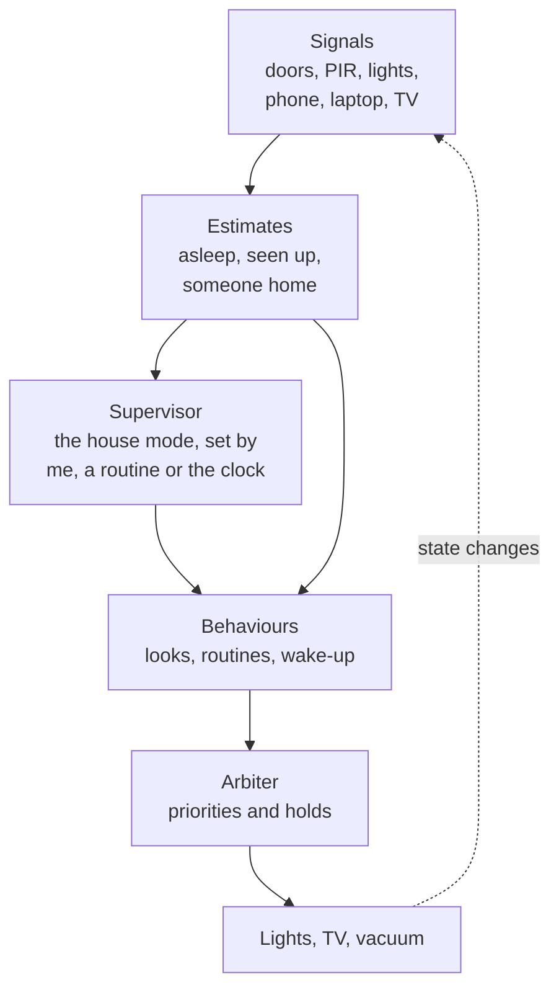
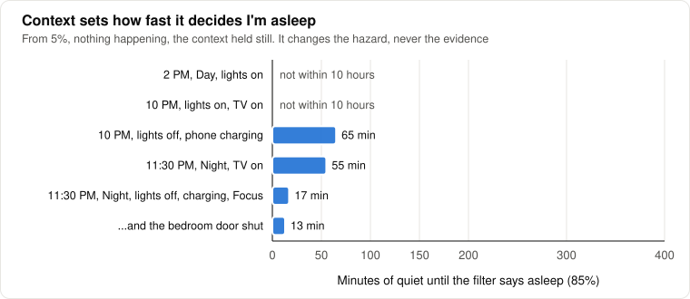
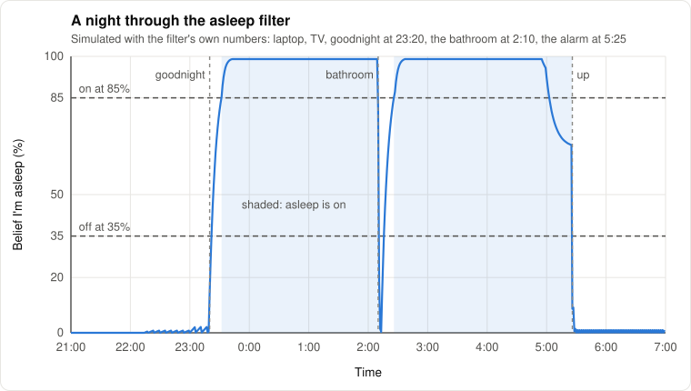
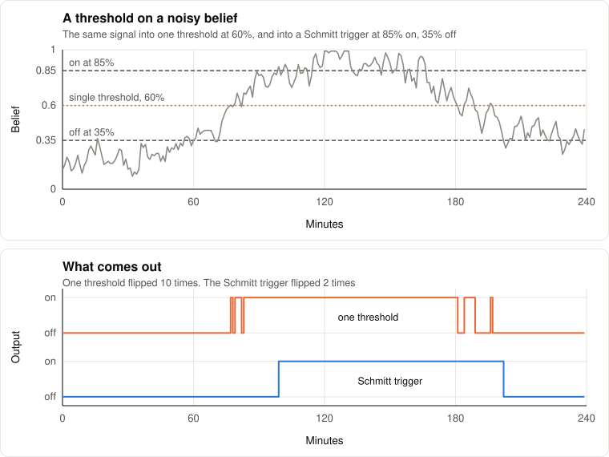
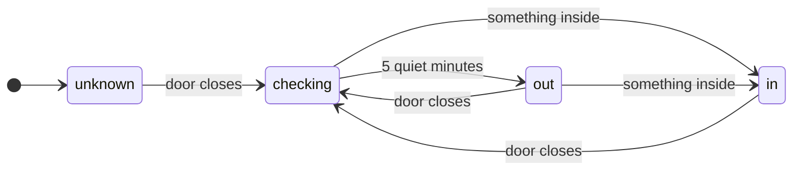
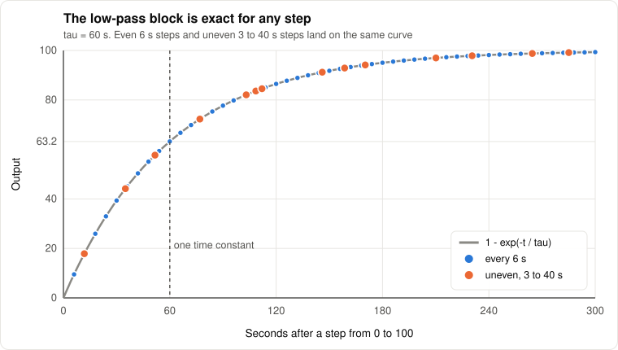
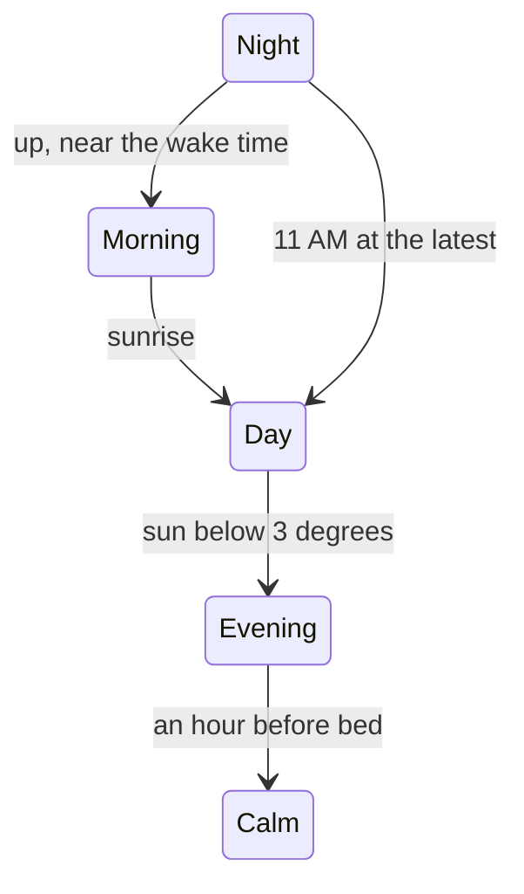
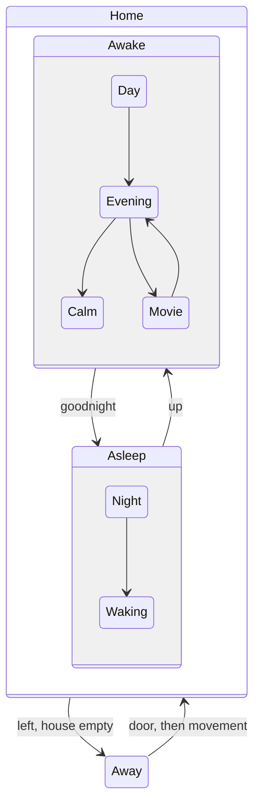
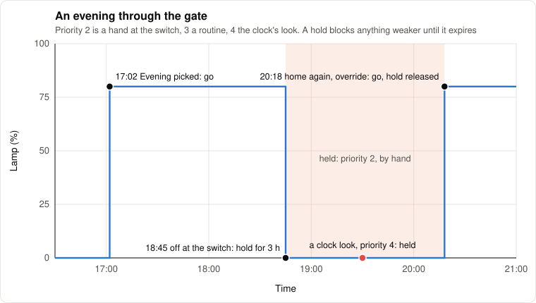
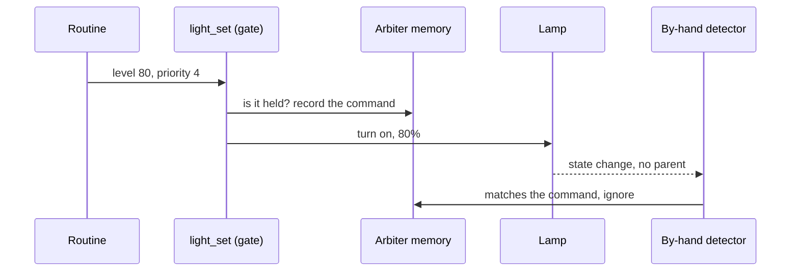

# How the house decides

*Level 3 to 4. The house as a control system: what it estimates, how it filters, who gets to drive
a light, and the math under each block. Later sections get into the weeds.*

This house is about sixty automations, and for a while every one of them was its own little
controller: read a few sensors, make up its own mind about what they meant, drive a few lights.
That works until two of them disagree, or one misreads the world, which is exactly what happened
the first morning the alarm ran. So this page is me asking the question I'd ask at work: if this
were a machine, how would I structure the controls?

Honest framing first. Almost every actuator in a house like this is a switch. Lamps on plugs,
kitchen bulbs that can't dim, a vacuum that's "go" or "home". So most of the control theory that applies isn't PID
loops, it's estimation and logic: working out what's true, deciding what mode the house is in, and
settling arguments between automations. The continuous blocks (filters, PID, eventually model
predictive control) are built and tested anyway, because the day a thermostat or the blinds show up
they'll be needed, and bolting them on later is how you get a pile again.

## The stack

Any controller does the same jobs in the same order: sense, estimate, decide, act. The house is
split that way on purpose, so each job is done once, in one place, and everything above it reads
the result instead of redoing it.



| Layer | What | Where |
|---|---|---|
| Blocks | the math: settings, Bayes step, hysteresis, low-pass, rate, PID, the gate | `custom_templates/control.jinja` |
| Estimates | what's true about me and the house | `custom_templates/estimates.jinja`, `packages/estimates.yaml`, `packages/occupancy.yaml` |
| Supervisor | the house mode, and who changed it | `packages/house_mode.yaml` |
| Behaviours | looks, routines, the wake-up, the off switches | `lights.yaml`, `routines.yaml`, `presence.yaml`, `wake.yaml`, `controls.yaml` |
| Arbiter | every light command through one gate, with priorities and holds | `packages/arbiter.yaml`, `script.light_set` |
| Tests | the whole stack against situations, with a frozen clock | `tests/`, see [testing.md](testing.md) |

The idea behind the split is the separation principle from control theory: build the best estimate
of the state you can, then design the controller as if that estimate were the truth. Two problems,
each solved once. Before this, "is he up?" was answered in three places, slightly differently in
each, and a bug in one copy quietly told the alarm I was out of bed. Now the wake-up asks
`sensor.seen_up` and nothing else.

| Estimate | Entity | Built from |
|---|---|---|
| Up and about | `sensor.seen_up` | the Hub seeing someone, typing at the computer, "I'm up", the bedroom door in the morning |
| Asleep | `sensor.asleep_belief`, `binary_sensor.asleep` | a Bayes filter, below |
| Someone home | `binary_sensor.someone_home` | the front door and what moves inside after it, below |
| Bathroom occupied | `binary_sensor.bathroom_occupied` | the door shut with the light on |
| Where you are | `person.resident`, Proximity, the arrival timers | phone, zone, distance and direction ([routines.md](routines.md)) |

What each raw signal really says, and how late, is its own page: [sensing.md](sensing.md).

## Estimating "asleep"

### Why not naive Bayes

The first version was Home Assistant's Bayesian sensor: a prior of a third and nine observations,
each with a likelihood ratio, combined in log-odds every minute:

```math
\ln\frac{P(\text{asleep}\mid o_{1..n})}{P(\text{awake}\mid o_{1..n})}
= \ln\frac{p_0}{1-p_0} + \sum_{i=1}^{n} \ln\frac{P(o_i\mid \text{asleep})}{P(o_i\mid \text{awake})}
```

With its numbers, the prior starts at $`\ln(0.33/0.67) \approx -0.7`$. The house in Night is worth
$`\ln(0.75/0.05) \approx +2.7`$ and "it's after 11" $`\ln(0.85/0.12) \approx +2.0`$. Those two
alone reach +4.0, a probability of 98%, before a single real sign of sleep. And they aren't
independent at all: the house goes to Night because it's late. Counting correlated evidence as if it
weren't is the classic way naive Bayes gets overconfident.

The bigger problem was memory. It recomputed from the prior every minute, so the moment the
observations said "asleep" it was over 90% sure, and the moment they didn't it forgot. Replay a night
through both and it shows:


*The old sensor never noticed me get up at 2:10. The filter did, and went back to sleep with me.*

### The filter

Asleep is a hidden state $`s_t \in \{\text{awake}, \text{asleep}\}`$, stepped once a minute. That's
a two-state hidden Markov model run forward, a Bayes filter, with one twist: the chances of moving
between the states depend on the context $`u_t`$, which makes it an input-output HMM. Predict, then
correct:

```math
\bar b_t = (1 - h_w)\, b_{t-1} + h_e(u_t)\,(1 - b_{t-1})
```

```math
b_t = \min\!\left(\frac{\lambda_t\, \bar b_t}{\lambda_t\, \bar b_t + (1 - \bar b_t)},\; 0.99\right)
```

$`b_t`$ is the belief I'm asleep, $`h_e`$ the chance of falling asleep this minute and $`h_w`$ of
waking (hazards, in survival-analysis terms), and $`\lambda_t`$ the likelihood ratio of whatever
was observed this minute. It's `bayes_step` in `control.jinja` and `asleep_next` in
`estimates.jinja`, about thirty lines of Jinja.

The design decision that matters is what counts as evidence. The phone on the charger, the house in
Night, the lights off: those are true for hours at a stretch, and fed in as evidence every minute
they'd multiply into certainty, the same trap as before. So they don't go in as evidence. They set
the hazard, which is what they really change: a dark, quiet house at midnight makes falling asleep
likelier, it doesn't prove it happened.

```math
h_e(u_t) = \min\!\Bigl(h_0(\text{hour}) \prod_i m_i(u_t),\ 0.3\Bigr), \qquad h_e = 0 \text{ while I'm typing}
```

| | Value |
|---|---|
| $`h_0`$, 11 PM to 4 AM | 0.008 per minute |
| $`h_0`$, 9 to 11 PM and before 7 AM | 0.003 |
| $`h_0`$, daytime | 0.0003 |
| House in Night | × 3 |
| Every light off | × 2 |
| Quiet for 15 min / 45 min | × 3 / × 6 |
| Phone on the charger, Focus on | × 1.5, × 1.3 |
| TV on | × 0.5 |
| Bedroom door shut at night | × 1.5 |
| $`h_w`$ | 0.002, × 4 from 5 to 11 AM, × 5 while the wake-up runs |

The only evidence each minute is something happening. A sign of life since the last update (the Hub
seeing someone, a light switched by hand, a door inside) is twenty times likelier awake,
$`\lambda = 0.05`$. Typing is a thousand times, $`\lambda = 0.001`$. Nothing happening is no
evidence at all, $`\lambda = 1`$, and then the step is pure prediction. "Since the last update"
rather than "in the last 60 seconds", so an event landing exactly on a tick still counts once.

### The fixed point and the time constant

With no evidence and the context held still, the prediction step is a linear recursion, and it has
a fixed point and a time constant:

```math
b^{*} = \frac{h_e}{h_e + h_w}, \qquad b_t - b^{*} = (1 - h_e - h_w)^{t}\,(b_0 - b^{*})
```

So the belief relaxes towards $`b^*`$ with a time constant of about $`1/(h_e + h_w)`$ minutes, and
it can only ever say "asleep" if $`b^*`$ is above the 85% line. At 10 PM with the lamp and the TV
on, even after 45 quiet minutes, $`h_e = 0.003 \times 6 \times 0.5 = 0.009`$ and
$`b^* = 0.009 / 0.011 = 0.82`$. It will never decide I'm asleep in front of the TV, however still I
sit, which is right: I watch things very still. In the dark after goodnight $`h_e`$ starts around
0.14, reaches the 0.3 cap at fifteen quiet minutes, and the belief crosses 85% a little before
that.



*The context only changes how fast it gets there, and whether it can at all.*

Evidence works the other way. From the 0.99 cap, the correction alone for one minute with a sign
of life gives

```math
b = \frac{0.05 \times 0.99}{0.05 \times 0.99 + 0.01} \approx 0.83
```

(0.82 with the prediction step in front of it), and a second minute takes it to about 0.2, under the
35% line. Two minutes of moving about and I'm awake. That's why it's capped at 0.99: from 0.9999 the
same trip would take three minutes to register, and the morning's "is he up?" would be answered
late.



*A simulated night, run through the same equations and numbers as the real one.*

### Hysteresis on top

`binary_sensor.asleep` is the belief through a Schmitt trigger: on at 85%, off at 35%, and in
between it stays as it was.

```math
y_t = \begin{cases} 1 & b_t \ge 0.85 \\ 0 & b_t \le 0.35 \\ y_{t-1} & \text{otherwise} \end{cases}
```

A belief wandering around one threshold makes the output chatter, and every chatter is an
automation firing. The gap between the two lines is the noise the output ignores.



*Same signal, two outputs. Everything that reads "asleep" sees the bottom line.*

### Checking it against the ring

A sleep tracker like the Oura ring knows when you actually fell asleep, but only hours later,
after it syncs, so it can't drive anything. It can grade the filter: every morning `sensor.asleep_guess_error` is the gap
between the filter's first "asleep" and the ring's bedtime. A few weeks of that and the hazards
above stop being educated guesses. Van Kasteren's work on real homes found that modeling how long
states last beats a plain HMM, and the hour-dependent hazard is a cheap version of that.

## Estimating "someone home": the wasp in a box

The phone isn't the person. The first day mine spent an afternoon somewhere without me, I came
home and left again twice without the house noticing. A guest on their own has the same problem.

The fix is an old one from the home automation crowd, called the wasp in a box: nobody gets in or
out without the front door, so if anything inside moves after the door closes, someone's in, and
they stay in until the door opens again. It's a four-state machine (`occupancy_next` in
`estimates.jinja`):



"Something inside" is the Hub's PIR (not while the robot vacuum is out or just docked), a light
switched at the wall, a door inside, the TV coming on, typing, talking to Jarvis. `someone_home` is on
for `in` and `checking`, so a door closing never makes the house empty by itself, and without a
door sensor it falls back to the phone.

The invariant is what makes it trustworthy: with the door shut, the set of people inside can't
change, so one sign of life proves presence until the door opens. It can be wrong in two ways. A
person inside who doesn't move for five minutes after the door closes reads as empty, which does
happen (a guest asleep on the couch), so leaving with someone still "in" doesn't go Away, it sends a
note with a "Nobody's home" button.

Five minutes is from the data. It started at ten, and the first two days with the door sensor had
eleven closes with someone inside afterwards. Ten of them showed a sign of life within 74 s, most
within 15 (the Hub's PIR, mostly). The eleventh took 8.7 minutes, one evening, and the data can't
say whether I'd stepped out or was sitting still: the phone never left the Wi-Fi. That's
also why it's safe. With the phone home a wrong "out" changes nothing, because leaving needs the
phone gone as well, and the cost of ten was every exit leaving the lights on for 10 minutes. And an "inside" event that wasn't a person inside reads as
someone home. The robot vacuum is the obvious one and it's filtered out. The sneakier one was the app:
the first version took every light changed by hand, so turning off a lamp I'd forgotten, from the
stairs on the way out, would have kept the house "in" with nobody there. Now only the wall counts
(`by: wall` on the arbiter's `light_manual` event), and `test_presence.py` has both cases.

## The blocks

`control.jinja` holds the math, as Jinja macros any template can import. They take their state in
and hand it back out, so one macro serves any number of loops, and each is tested on its own in
`tests/test_blocks.py` before anything depends on it.

### Low-pass

A first-order low-pass filter, discretised exactly rather than with the usual Euler step:

```math
y_k = y_{k-1} + \alpha_k\,(x_k - y_{k-1}), \qquad \alpha_k = 1 - e^{-\Delta t_k / \tau}
```

That's the exact solution of $`\tau \dot y = x - y`$ for an input held constant over the step, so
it doesn't matter how unevenly the updates arrive. Home Assistant's triggers are anything but even,
and an Euler filter, $`\alpha = \Delta t / \tau`$, would change its own time constant every time an
update came late (and go unstable for $`\Delta t > 2\tau`$).



*The test: ten 6 s steps with tau 60 s must reach 63.2%, one time constant.*

### Rate of change

`rate(prev, x, dt)` is a finite difference. On a noisy signal it amplifies the noise: with
measurement noise of variance $`\sigma^2`$ on each sample,

```math
\mathrm{Var}\!\left[\frac{x_k - x_{k-1}}{\Delta t}\right] = \frac{2\sigma^2}{\Delta t^2}
```

so the faster the updates, the worse it gets. A shower is the use I have in mind (bathroom humidity
climbing a few percent a minute is a shower and nothing else is), and it gets the low-pass first.

### PID

One step of a PID controller with its state (integral, last measurement) carried as JSON:

```math
u_k = \mathrm{sat}_{[u_{\min}, u_{\max}]}\!\left(K_p e_k + K_i I_k - K_d \frac{y_k - y_{k-1}}{\Delta t}\right),
\qquad e_k = r_k - y_k
```

Two details that matter. The derivative is on the measurement, not the error, so changing the
setpoint doesn't kick the output. And the integral only grows when it's helping:

```math
I_k = \begin{cases} I_{k-1} & \text{if the output would saturate and } e_k \text{ pushes further into it} \\ I_{k-1} + e_k\,\Delta t & \text{otherwise} \end{cases}
```

That's conditional integration, the simplest anti-windup there is. Without it, asking for something
impossible for ten minutes piles up an integral that takes another twelve to unwind, and the plant sits
pinned at the limit long after the request went back to something reasonable.


*The test closes the loop around a simulated room and checks both: no offset, and no windup.*

Nothing in the house runs a PID loop yet. Daylight harvesting is the first candidate: hold the
living room at a light level by dimming a floor lamp as the sun moves, a PI loop with a slow time
constant so nobody sees it hunt. The light curve ([lighting.md](lighting.md#the-light-curve)) is the
open-loop version of it today, working the daylight out from the sun and the cloud forecast, and the
`window-light` node ([esp32.md](esp32.md)) is the lux sensor that would close it.

### The settings

Every threshold and hold time is a named entry in `param()`, so changing one is one line and the
reason lives here instead of in a number typed into some automation:

| Setting | Value | Why |
|---|---|---|
| Hold after a light changed by hand | 180 min | the evening's clock changes leave my choice alone |
| Hold on the bedroom for the alarm | 75 min | the sunrise and the escalation own the bedroom until well after the wake time |
| Command settle time | 10 s past the fade | a light finishing its fade isn't a person |
| Command match window, tolerance | 120 s, 6% | a light reporting the asked level late isn't a person either |
| Asleep on, off, cap | 85%, 35%, 99% | the hysteresis band, and the cap that lets two minutes wake it |
| Ambient in the dark, in full sun, in the wind-down | 80%, 50%, 35% | the light curve ([lighting.md](lighting.md#the-light-curve)): the windows do the work by day, about 30 lux at the eye before bed |
| Colour: morning, evening and the floor | 4000 K, 2700 K | cool to get going, warm from mid-afternoon; nothing warmer, the floor lamp loses most of its light below 2700 K |
| Full daylight from | 35 degrees of sun | a first guess until the window sensor measures it |
| Wind-down ramp | 60 min | the curve's way into the wind-down |
| Blend step, each minute | 5% of the level (2 points at least), 3 mired | under what anyone notices: a quick 20% drop usually goes unseen, and about 5 mired is the smallest colour difference side by side ([lighting.md](lighting.md#blending-not-switching)) |
| Blend fade, blend window | 60 s, 45 min | each step fades over the minute it has, and every layer keeps blending for 45 minutes after the clock changed the look |
| Calm | the hour before the planned bedtime | it was 9:30 PM, whatever the bedtime |
| Empty after the door, arrival after the door | 5 min, 10 min | the wasp in a box (10 of 11 closes with someone in showed a sign within 74 s), and how long a door opening counts as "just came in" |

## Who changes the mode

The house is always in one of seven modes (Morning, Day, Evening, Movie, Calm, Night, Away), and
each mode maps to a look ([routines.md](routines.md)). Three kinds of thing change it, and the
house remembers which one did last (`input_text.house_mode_by`), because they don't deserve the
same respect:

- me, from the dashboard or by voice: always goes, and ends any lights I'd held by hand
- a routine (arriving, movie night, goodnight): goes, at routine priority
- the clock: only moves along a few edges, and leaves lights I switched by hand alone



Those are the clock's only moves. Everything else is me or a routine. Even so, any mode can still
jump to any other, which is how a trip past the Hub at 4:45 once set Morning before the alarm (now
fenced off inside the Night to Morning edge). The cleaner model is Harel's statecharts: states
inside states, with a transition table that refuses the rest.



That's what I'd like the supervisor to become: "Morning from Night only through Waking" is one row
in a table, instead of a condition I have to remember in four automations. Guests and quiet would be
orthogonal regions, flags alongside the mode instead of more modes.

## Who gets the light

### Priorities

The looks, the wake-up, the fell-asleep check, movie night and me at the wall all write to the same
lights. Brooks' subsumption architecture (1986) is the robotics answer: behaviours in layers, and a
higher one suppresses the ones below without them knowing. Here that's a priority on every request,
lower number wins:

| Priority | Who |
|---|---|
| 1 | the alarm and safety |
| 2 | me, by hand (and the fell-asleep check, which has to beat a light I switched on before dozing off) |
| 3 | routines |
| 4 | the mode's look |
| 5 | background |

Every light command goes through `script.light_set`, which asks the gate first and can leave a
hold behind. A hold on light $`e`$ is $`H_e = (p_h, t_h, \text{source})`$: nothing weaker than
$`p_h`$ may change $`e`$ before time $`t_h`$. The gate for a request of priority $`p`$:

```math
\mathrm{go}(e, p, o) = \bigl[t \ge t_h\bigr] \ \lor\ \bigl[p_h \ge p\bigr] \ \lor\ \bigl[o \land p_h \ge 2\bigr]
```

Equal priority goes (the newest wins, so the alarm's next sunrise step passes its own hold), and
$`o`$ is override, set when I pick a mode myself: it passes my own holds and anything below, never
the alarm's. The holds live in `sensor.light_arbiter`, a template sensor that folds each
`light_hold`, `light_release` and `light_commanded` event into its own attributes.



*The hold is what makes the house respect what I just did.*

### What counts as "by hand"

The holds only work if the house can tell me at the switch from itself. Every state change in Home
Assistant carries a context, and an automation leaves its fingerprint on what it changes (a parent
id), so the first version just checked for that. The test bench found the hole: an automation started
by the clock leaves no parent either, and neither does a light reporting back late from a fade. The
alarm starts that way, so its sunrise looked exactly like me.

So the gate writes down what it asked each light for before asking: level $`\ell_c`$, fade
$`f_c`$, time $`t_c`$, and where the light started, $`\ell_0`$. A change of light $`e`$ from state
$`x`$ to $`y`$ at time $`t`$ is a person only if it carries no parent and isn't explained by the
last command:

```math
\text{explained} = \bigl( t - t_c \lt f_c + 10\,\text{s} \land y \text{ on the way} \bigr) \ \lor\ \bigl( s(y) = (\ell_c > 0) \land \lvert \ell(y) - \ell_c \rvert \le 6\% \land t - t_c \lt 120\,\text{s} \bigr)
```

where on the way means on, somewhere between $`\ell_0`$ and $`\ell_c`$ give or take 6%, or off
when off is what was asked. From off there's no knowing the way (a light switched on comes up at
whatever it had last), so anything goes. The first version accepted any change during the fade, which
was fine for 3-second fades and blind once the blending (lighting.md) has a fade running on the
lamp nearly every minute. Plus a change has to be real (on to off, or more than 8 of 255 in
brightness) to be looked at at all. The context then only says which person: the dashboard and
Jarvis carry a user id, the wall doesn't.



One lamp broke this in an instructive way. A Govee floor lamp reported its brightness as 202,
203, 202, 203, more than once a second, for hours, and every flicker looked like me. I'd assumed
rounding between Matter's 1 to 254 and Home Assistant's 0 to 255. It wasn't: the lamp's Level
Control cluster said "53.8 seconds of fade remaining" and never got any closer. The Govee firmware
gets stuck mid-fade when one command changes the colour and the brightness together with a
transition. So the gate sends them as two commands, colour first and straight there, then the
brightness with the fade, and the lamp has been quiet since. Fixed where the data comes from, not
filtered after it.

## When a part is missing

The first real morning, the alarm didn't go off. The automation that starts it errored every
minute from its first tick (a time passed through a variable comes out as text), every test had
called the script directly, and nothing woke me until I woke up by myself. Two lessons came out of
it.

The first is redundancy, the plain kind from work. Critical alerts don't reliably wake a deep
sleeper, so a warning that
something broke is worth less than something that keeps working. Every action that talks to a device
carries on past a failure (`continue_on_error`), so a dead bedroom light still leaves the lamp, the
voice and the phone. And the wake-up has a backstop that shares nothing with it but the plan: three
minutes past the wake time, if the wake-up isn't running and nothing independent says I'm up, it
goes straight to a critical alert, full volume and the bedroom lights. If the two fail independently,

```math
P(\text{no alarm}) = P(\text{main fails})\,P(\text{backstop fails})
```

which is the whole argument for them sharing no code. A typo can't take out both.

The second is testing the real path, the trigger included, against a clock. That's
[testing.md](testing.md).

## What the research tried

People have been building houses that think since the nineties, and the good projects are worth
stealing from.

Mozer's Adaptive House (Colorado, mid nineties) is still my favourite. Seventy-five sensors, the
lights and heating run by reinforcement learning, and discomfort converted into dollars so it could
be weighed against the energy bill. When Mozer hit a wall switch to complain, the house brightened
the light and punished itself. The wall switch as a training signal: my by-hand detector is half of
that idea already, it just doesn't feed back yet.

MavHome and later CASAS (Cook and others, Washington State) treated the home as an agent
predicting the next activity, then went cheap: motion and door sensors, no cameras, activity
recognition on top. Van Kasteren and colleagues did the careful version on 28 days of labeled
data, HMMs against conditional random fields, and found that modeling durations (semi-Markov models)
beat both.

The commercial and community systems that work have converged on the same shape: a house mode on
top (SmartThings and Hubitat call them modes), rooms underneath (Lutron and Control4 are room-first,
Home Assistant's Magic Areas does it with room states), things addressed by what they are rather
than by name (openHAB's semantic model, the light layers here), and manual wins for a while (Adaptive
Lighting's "take over control"). This house has all of that except rooms, which need sensors first.

What I'd take: estimate the hidden state properly, treat a manual override as data, model
durations. What I'd leave: anything that needs months of labeled data. This is one person in one
apartment, and learning has to work with a handful of nights.

### Model predictive control

MPC predicts forward with a model, picks the best sequence of moves over a horizon, applies the
first, and does it all again next step. For a room with heating it would minimise comfort against
energy over the next few hours:

```math
\min_{u_0 \ldots u_{N-1}} \ \sum_{k=0}^{N} \Bigl( w_c\,(T_k - T_{\text{want}})^2 + w_e\, E_k \Bigr)
\quad \text{s.t.} \quad T_{k+1} = a\,T_k + b\,u_k + c\,T_{\text{out},k}
```

which is Mozer's dollars-for-discomfort written down. Oldewurtel and colleagues showed weather
forecasts doing this saves real energy in buildings, because heating is slow and knowing what's coming
beats reacting. It only pays when the plant is slow and there's something to predict, so a
thermostat or the blinds. It's too much for templates: it would be a small Python service on the
Hub, like the stats and the LED ring, sending its first move through the same gate at a priority.

## What an ESP32 would add

ESPHome on an ESP32 is the cheapest way to add sensors and, more interesting, local control. A node
runs its own automations on the chip, so it keeps working while Home Assistant restarts (with
`reboot_timeout` off, or it reboots itself after 15 minutes alone). The sensor side has its own page
now ([esp32.md](esp32.md)), and the path light there is the first node that decides for itself: it
asks Home Assistant whether it's Night and falls back to its own clock when there's no answer.

- A bedroom node: in [esp32.md](esp32.md) it's an LD2410C radar (still bodies, which is what "in
  bed" needs), with an LD2450 for positions and a bed zone as the experiment after it, CO2 if the
  nights say so, and a Bluetooth proxy
- On the same node, an alarm that doesn't need Home Assistant: a small speaker, with the wake time
  copied over each evening. The backstop's backstop
- Load cells under the bed legs, the most direct "in bed" there is
- The blinds, when they happen: the stepper and its limits on the board, Home Assistant only saying
  where to go

## What I'd like to build next

In the order I think they pay off:

1. Checked actions on the critical paths: command, read back, retry, then the other light
2. "Pause for three days" on the off switches, so they come back by themselves
3. The mode statechart, with its transition table
4. The bedroom ESP32 node with its own alarm
5. Looks that learn their brightness from my overrides: every one already reaches the arbiter, and
   an exponentially smoothed nudge per look and hour would converge in a week or two
6. Daylight harvesting on a floor lamp, the first real PI loop, once the `window-light` node is
   in the window

## References

- [Mozer, the neural network house](https://home.cs.colorado.edu/~mozer/Research/Selected%20Publications/nnh_overview.html): discomfort in dollars, the wall switch as a training signal
- [Mozer et al., the Neurothermostat (NIPS 1996)](https://papers.nips.cc/paper/1996/hash/a0833c8a1817526ac555f8d67727caf6-Abstract.html): occupancy prediction and a planning horizon for heating
- [MavHome publications](https://ailab.wsu.edu/mavhome/publications.html): the home as an agent, prediction at the core
- [Cook et al., CASAS: a smart home in a box](https://pmc.ncbi.nlm.nih.gov/articles/PMC3886862): cheap ambient sensors, recognition on top
- [Van Kasteren et al., accurate activity recognition in a home setting](https://research.utwente.nl/en/publications/accurate-activity-recognition-in-a-home-setting/): HMM and CRF on 28 days of real data
- [Van Kasteren et al., semi-Markov models on smart home data](https://www.dare.uva.nl/id/f6c70817-c5ad-4351-9d1d-9ab5bd39d6b2): modeling durations beats the plain HMM
- [Bengio and Frasconi, input-output HMMs (NIPS 1994)](https://papers.nips.cc/paper/1994/hash/8065d07da4a77621450aa84fee5656d9-Abstract.html): transition probabilities that depend on an input, the shape of the asleep filter
- [Oldewurtel et al., MPC with weather forecasts for building climate control](https://infoscience.epfl.ch/record/176005/files/frauke_eab_2012.pdf?version=1): prediction beats rules when the plant is slow
- [Brooks, subsumption architecture](https://en.wikipedia.org/wiki/Subsumption_architecture): layered behaviours, higher ones suppress lower
- [Harel, statecharts: a visual formalism for complex systems (1987)](https://www.inf.ed.ac.uk/teaching/courses/seoc/2006_2007/resources/statecharts.pdf): states inside states, the model for the supervisor
- [Åström and Murray, Feedback Systems](https://www.cds.caltech.edu/~murray/amwiki/): PID, windup and the rest, the readable textbook (free online)
- [Adaptive Lighting](https://github.com/basnijholt/adaptive-lighting/blob/master/README.md): "take over control", manual wins
- [Magic Areas](https://github.com/jseidl/hass-magic_areas): room states as a layer
- [ESPHome native API](https://www.esphome.io/components/api): the reboot timeout

Next: [what the house can see](sensing.md), because every estimate on this page is only as good as
the signals under it.
