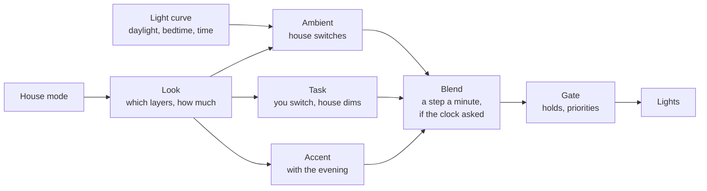
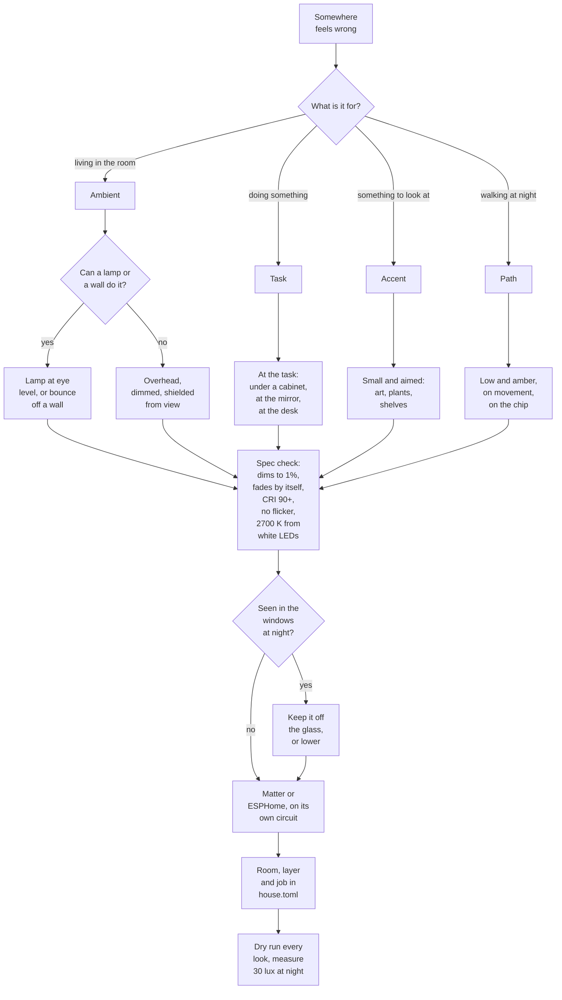

# Lighting by layer

*Level 3. How the lights are organised, what the research behind that looks like, the curve the
ambient light follows through the day, how the house changes a light without anyone noticing, and
the flowchart I use before buying another light.*

Lighting designers have treated daylight as the primary light and electric light as the supplement
since at least Richard Kelly in the 1950s, and the 2022 consensus on light and sleep says the same
thing in its own words: use daylight first. So for most of a sunny day the lamps here are
decoration, sitting low, and they come up as the daylight goes. The two habits a house tends to
fall into are the opposite of that: switching the lamps off during the day while someone's home,
and putting the harsh overhead on at full in the morning whether anyone wanted it or not. Both are
things this page is set up to avoid.

## Three layers

Kelly gave the field its vocabulary in a 1952 lecture to architects and illuminating engineers:
*ambient luminescence* (the light that fills the room and lets you see), *focal glow* (light that
picks something out, the pool at a reading chair) and *the play of brilliants* (sparkle). Today's
guides call them ambient, task and accent, and every one of them says to layer them rather than
light a room from one source.

There's a trap in the word ambient, though. In the industry it means the general light, which in
most houses comes from the ceiling, while what most people would call "the ambient lights" is a
strip behind the couch, which is really indirect light on a wall. So the house classifies by what a
light is for, and how it lights the room is a separate question. Some typical ones:

| Light | Layer | How it lights |
|---|---|---|
| A floor lamp | ambient | eye level, soft |
| A strip behind the couch | ambient | indirect, off the wall |
| A bedside lamp | ambient | eye level, soft |
| A bedroom overhead | task (and the sunrise, and the room's stand-in) | overhead, hard |
| A kitchen ceiling | task | overhead, hard, often can't dim |
| A bathroom ceiling | task | overhead, hard |
| A printer's case light | accent | sparkle |

Each layer has its own rule. Ambient is the house's job, on whenever someone's home and awake, at
a level and colour that follow the day. Task is the person's: on when they ask or flip the switch,
and the house only ever dims it or turns it off. Accent rides along with the evening. That one
split is most of what makes the control side easy, because the question "should the house switch
this on?" has the same answer for every light in a layer.

A layer is what a light is doing, though, not what it is, and one fixture can do two jobs at
different levels. DALI already works that way: a light can sit in several groups and keeps its own
level for each scene. A bedroom overhead is a task light at its usual levels and could be ambient in
its bottom 15%, but it's a poor ambient light, a downlight lighting the floor instead of the walls
(Cuttle, below), and most nights nobody wants it on. So a light with the stand-in job only takes
over its room's ambient level when every ambient light in that room is dead: the lamp's plug drops
and the room gets a low glow instead of going dark. The layers and the jobs are labels, set from
the `[[light]]` tables in `house.toml` ([devices.md](devices.md#lights)).

## What's on when

| Time | Ambient | Task | Accent |
|---|---|---|---|
| Morning | on, 4000 K | when asked (the sunrise light does the sunrise) | on |
| Day | on as a glow, lower in full sun | when asked | as it is |
| Dusk | up as the daylight goes | when asked | on |
| Evening | on, 2700 K | when asked, dimmed if it dims | on |
| Wind-down, 3 h before bed | low, 2700 K, about 30 lux at the eye | discouraged | on |
| Calm, the last hour | the same | dimmed to 20% if it's on | low |
| Night | off, a path light on movement later | off | off |
| Film | off | off | low |
| Away | off | off | off |

The numbers at the eye come from Brown and colleagues' 2022 consensus in *PLOS Biology*, the
closest thing the field has to agreed advice. It's written in melanopic EDI, which is roughly "how
much this light talks to the body clock", measured vertically at seated eye height: at least 250
lux of it through the day, ideally from daylight, at most 10 from three hours before bed, and at
most 1 while asleep. Warm LEDs carry about a third of their light as melanopic, so 10 melanopic is
about 30 ordinary lux of warm white, which is what the paper says most homes sit at in the evening
anyway.

The three hours is the bit with teeth. With a 9:40 PM bedtime the wind-down starts at 6:40, so most
of a weekday evening is wind-down. That's what the research says, and it's a setting
(`input_number.wind_down_hours`) because you might find you disagree with it.

## Why lamps and not the ceiling

Three separate lines of evidence land in the same place.

How bright a room looks depends on the light coming off its walls and other surfaces, not on how
much lands on the floor. Christopher Cuttle's mean room surface exitance (MRSE, the average light
leaving the room's surfaces) predicts how adequately lit people judge a room, and horizontal
illuminance doesn't. Downlights mostly light the floor. A lamp or a strip on a wall puts its light
where the eye judges brightness, so the room reads brighter for fewer watts.

How a room feels: John Flynn's studies in the 1970s found uniform overhead light reads as clear and
public, and uneven, peripheral, warm light as relaxing and private. The IES Lighting Handbook has
carried his findings ever since, and to be fair Jennifer Veitch has pointed out that they were never
independently replicated, so I treat them as strong design rules rather than laws. They match what
anyone feels walking from an office into a living room with a few lamps on.

Sleep: the evening limit above is easy with low, warm light off to the side, and hard with a bright
ceiling in your field of view.

One thing I had wrong in my head. The Kruithof curve, the old rule that dim light should be warm
because people prefer it that way, doesn't survive a proper look: Steve Fotios's 2017 review of the
credible studies found colour temperature barely moves how pleasant a room feels. The reason for
warm light at night is the body clock, not taste.

## The light curve

The ambient layer's level and colour come from one function of the day,
`light_curve()` in the control core (`custom_components/house_control/curve.py`, with
`sensor.light_curve` to watch it), instead of a number per mode. Three inputs: how
much daylight there is, how close bedtime is, and the time.

Daylight first. Until there's a sensor on the window sill it's worked out from the sun's height
$`h`$ and the forecast's cloud cover $`c`$ (0 to 1), with the cloud factor from Kasten and Czeplak's
1980 fit for how clouds cut solar radiation:

```math
D = \min\!\left(1, \frac{\sin h}{\sin 35^\circ}\right)\left(1 - 0.75\,c^{3.4}\right), \qquad D \in [0, 1]
```

Full daylight from 35 degrees up is a first guess, the kind of number the window sensor is for. The
wind-down comes from tonight's
planned bedtime $`t_b`$ and the setting $`H`$ (3 hours), as a smoothstep over the hour before
$`t_b - H`$:

```math
w = s\!\left(\frac{H + 1 - (t_b - t)}{1}\right), \qquad s(x) = x^2(3 - 2x) \text{ clamped to } [0,1]
```

and $`w = 0`$ from the planned wake time onwards. Then the two outputs:

```math
\ell = \ell_d - (\ell_d - \ell_s)\,D, \qquad \ell \leftarrow \ell + (\ell_w - \ell)\,w
```

```math
K = 4000 - 1300\,s\!\left(\frac{\tau - 13}{2}\right), \qquad K \leftarrow K + (2700 - K)\,w
```

with $`\ell_d = 80\%`$ in the dark, $`\ell_s = 50\%`$ in full sun, $`\ell_w = 35\%`$ for the
wind-down, and $`\tau`$ the clock in hours, so the colour eases from 4000 K to 2700 K between 1
and 3 PM. $`H`$ is on the dashboard, the rest are in `param()` with the house's other settings.

The colour used to carry on to 2200 K by $`w`$. Now 2700 K is a floor for every light the house
sets: below it the floor lamp gets a lot dimmer (my guess is its warm-white LEDs stop at 2700 and
the rest is mixed from red), so 35% at 2200 K was never the same light as 35% at 2700 and the
wind-down was two dimmings stacked. A 2700 K white talks to the body clock a little more, but my bet
is that's small next to a dimming that takes off more than half.


*A mid-October day, simulated with the house's own numbers. With an early bedtime the wind-down
arrives before the evening peak would.*

Every minute the ambient lights that are on, and not held by hand, take a step toward where the
curve is now, and how big a step is the next section.

## Blending, not switching

How fast a change lands should depend on who asked for it. When you ask, under a second. When the
house changes something on its own, you shouldn't see it happen at all. The clock's mode changes
used to break that: Calm at a fixed 9:30 PM took the floor lamp to 40% amber in three seconds.

| Who asked | How fast |
|---|---|
| You: a switch, Jarvis, the dashboard | under a second |
| A routine you started: movie night, goodnight | a 2 to 5 second fade |
| Coming home | lit before the door opens |
| The house: the curve, Evening at dusk, Calm, Day | a step a minute, too small to see |

"Too small to see" has numbers behind it. The NRC's review of dimming for load shedding (Newsham
and colleagues) found a quick drop of up to about 20% goes unnoticed and a slow one more, and their
own lab dimmed at 2% a minute. Eyes judge brightness by ratio (Weber's law, and the reason DALI's
dimming curve is logarithmic, each of its 254 steps 2.8% above the last), so a step is 5% of where
the light is, 2 points at least near the bottom. Colour steps in mired, a million over the kelvin,
because equal steps in mired look equal (Priest, 1932). About 5 mired is the smallest difference
people pick out side by side, so the house moves 3 a minute. Evening's 70% to Calm's 50% on the
printers' light takes six minutes.

The sample rate I was worried about turned out to be the easy part. A Matter command carries its
own fade time, so one command a minute with a 60-second fade is a continuous ramp done by the lamp
itself, and a few hundred bytes a minute is nothing to the Wi-Fi. What argues against going faster
is the recorder writing down every change and the by-hand detector having to check each one
([control.md](control.md#what-counts-as-by-hand)). Adaptive Lighting landed close by, 90 seconds
with 45-second fades. The catch is colour on some lamps: fading colour and brightness together
hung a Govee floor lamp's firmware, so colour jumps to each step, and the step itself has to be under
what's visible. The same lamp turned out not to do a slow fade at all. Asked for 60% to 63% over a
minute it stays at 60, wobbling a step either side, and the next minute the same step goes out
again. Sent straight there, it lands inside a second and sits still. So a lamp like that gets the
`no_fade` job and everything to it goes with no fade, blend steps included, which is fine because 5%
at once is a quarter of the quick 20% drop the NRC found goes unnoticed. Home Assistant's Matter
integration already drops the fade for two other Govee lights, so I doubt this one's alone. A house
that worked it out by itself would only find out a minute after each step, every step, so I'd
rather say it once in `house.toml`.

The one change that skips the blend is a lamp restarting. Some colour lamps restart now and then,
often while their Matter connection is dropping, and come back at their own default colour with
nothing in the house having asked (the Govee comes back at 4000 K). Blending from there means 40
minutes of a cold lamp walking back to 2700. The timing is the tell, a jump to exactly that colour
(`restart_kelvin` in `control.jinja`) with no command from the house inside its fade and a few
seconds, so that one goes straight back and everything else still blends.

The same rule fits more than lights. The TV's volume already steps by a quarter of where it is,
which is Weber's law again, and the same NRC review found a drift of 1.5 °C over two or three hours
mostly goes unnoticed, so a thermostat here would ramp, never jump.

## The door

Coming home is the one moment where timing matters more than level. Robert Miller's 1968 work on
response times, the source of the numbers Jakob Nielsen made famous, puts the limits at about 0.1 s
for something to feel instantaneous and about 1 s before you notice you're waiting. Mine landed
1.1 to 1.2 s after the door opened, which is the edge. Any later and you're reaching for a switch,
and in this house a hand at the switch also puts a three-hour hold on that light, so a late light
doesn't just annoy once.

So with a doorbell, the welcome lights go on when it sees you and the phone's already on the Wi-Fi,
which tends to be 2 to 6 seconds before the door opens. The door finds the room lit. `sensor.door_to_light` keeps the
seconds from the door opening to the first light, negative when the room was lit first, one number
per arrival.

The level matters too, and it isn't "everything on". Tunnel lighting standards (CIE 88) brighten a
tunnel's entrance because eyes coming in from daylight see a dim tunnel as a black hole, and the
home version of that is a bright afternoon: walking in out of the sun, any home looks dark for a
moment whatever the lamps do. At night it's the other way round, eyes adapted to the dark don't
want a bright room. The welcome uses the curve, so a late arrival is dim and warm.

## How the control side maps

None of this needed a new architecture. The commercial standard for lighting control, DALI (IEC
62386), has lights, up to 16 groups, and up to 16 stored scenes per light. The house already had the
same three levels: lights, the labels that group them, and looks. What's different here is what the
groups mean (layers instead of fixture types) and the rule each one gets:



The gate is where the personal-control finding lives. Guy Newsham's field studies at the National
Research Council of Canada found people with control over their own lighting were measurably more
satisfied, and the arbiter's holds are that: whatever you set by hand stays for three hours, past
any look.

## Adding a light

Before buying anything, this is the order I go through. It's mostly the layers again, with the
practical checks that have bitten me (a kitchen dimmer on bulbs that can't dim, a lamp that came back
cold because nothing set its colour):



The spec check is short on purpose. Dimming to about 1% because the wind-down and the path light
live at the bottom of the range, where cheap drivers cut out or flicker. Fading by itself, a Matter
transition it actually honours, because that's how the house blends smoothly without a command every
second (Home Assistant keeps a list of lights that ignore it, and one that can't gets `no_fade`). A
CRI of 90 or more because low-CRI white makes skin and wood look grey. 2700 K from real warm-white LEDs, not faked with red ones, because
that's where the evening sits and a colour lamp that fakes it loses half its light down there. And
the window question because at night a big window is a mirror, and every bright source in the room
shows up in it twice.

## What I'd like to build next

- The window sill sensor (`esphome/window-light.yaml`, [esp32.md](esp32.md)), so $`D`$ is measured
  instead of worked out from the sun and the forecast. Then a floor lamp becomes the first proper
  closed loop in the house, the PI block it was built for
- Eye-level light sensors by the couch and the bed, so "about 30 lux at the eye" is a reading and
  not a guess at what 35% of a particular lamp does
- The path light from the bed to the bathroom (`esphome/path-light.yaml`)
- Lamps on dimmers instead of plugs, so the wind-down can turn them down instead of leaving them on
  at whatever they are
- A light sensor taped to a floor lamp for an evening, to see what the ones that can fade really do
  with a 60-second one, a smooth ramp or a staircase they hide well
- The same blending for Jarvis's quiet voice and the Hub's screen, and a ramp for a thermostat when
  there is one

## References

- [Brown et al., Recommendations for daytime, evening and nighttime indoor light exposure (PLOS Biology, 2022)](https://pmc.ncbi.nlm.nih.gov/articles/PMC8929548/): 250 by day, 10 from three hours before bed, 1 asleep, all at the eye
- [Richard Kelly's three tenets (Architect Magazine)](https://www.architectmagazine.com/?p=342744): ambient luminescence, focal glow, play of brilliants
- [Duff, Kelly and Cuttle on mean room surface exitance (TU Dublin)](https://arrow.dit.ie/sdar/vol2/iss1/3): rooms look bright from their surfaces, not their floors
- [Raynham, room lighting without a defined visual task (UCL)](https://discovery-pp.ucl.ac.uk/id/eprint/10040548/1/Raynham_Room%20Lighting%20in%20the%20Absence%20of%20a%20Defined%20Visual%20Task%28revised%29.pdf): MRSE and its alternatives
- [Veitch, Psychological processes influencing lighting quality (NRC)](https://nrc-publications.canada.ca/eng/view/accepted/?id=21939a53-a847-47c2-9bf8-60fea01b1c1f): Flynn's impressions, and why they need replicating
- [Durak et al., lighting arrangements and impressions (Building and Environment, 2007)](https://www.sciencedirect.com/science/article/abs/pii/S0360132306003830): wall washing, cove and general lighting compared
- [Fotios, the revised Kruithof graph (White Rose)](https://eprints.whiterose.ac.uk/98531/): colour temperature barely changes pleasantness
- [Nielsen, the three response time limits](https://nngroup.com/articles/response-times-3-important-limits): 0.1 s, 1 s, 10 s, after Miller
- [Lighting and gait in older adults (BMC Geriatrics, 2011)](https://pmc.ncbi.nlm.nih.gov/articles/PMC3176147/): lines of light on the floor beat a night light
- [Newsham et al., ramps in temperature and light level (ACEEE 2006)](https://www.aceee.org/files/proceedings/2006/data/papers/SS06_Panel4_Paper22.pdf): about 20% unnoticed fast, more slowly, 2% a minute in their lab, 1.5 °C over two or three hours
- [Mired](https://en.wikipedia.org/wiki/Mired): Priest's reciprocal scale, and the 5 mired difference
- [Home Assistant's Matter lights](https://github.com/home-assistant/core/blob/dev/homeassistant/components/matter/light.py): fades in tenths of a second, and the list of lights that ignore them
- [DALI groups and scenes (Lunatone)](https://www.lunatone.com/en/dali-factsheet/): the structure the looks copy
- [Rosetta Stone, personal control of lighting](https://rosetta.be.uw.edu/brief/electric-lighting-personal-control): Newsham's field results
- [Adaptive Lighting for Home Assistant](https://github.com/basnijholt/adaptive-lighting/blob/master/README.md): the community version of a curve, from the sun alone
