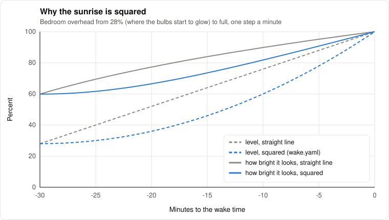

# Routines, modes and looks

*Level 2 to 3. What the house does by itself, built so a new light or routine is one row, not a
hunt through forty automations. The control structure under it is in [control.md](control.md).*

The way a house like this usually goes wrong is a pile of automations that each switch specific
lights: "at sunset, turn on the lamp and the strip", "at 10, dim the bedroom", and so on, forty of
them. It works until a lamp gets a dimmer or a new light goes in, and then you're hunting through
all of them for every place it should have been mentioned. This part of the house is the one that's
supposed to grow, so it's built to grow instead.

From the controls side it's a plain state machine with the outputs split off. The house is always
in one mode, things that happen move it between modes, and each mode maps to a look. Nothing
skips a layer.

## The four layers

The bottom layer is the lights themselves, each with a room, a layer and maybe a job. Ambient, task
or accent are the lighting designer's three ([lighting.md](lighting.md)), and the jobs (sunrise,
bedside, no-dim, stand-in, keep) are the handful of things a particular light does on top
([devices.md](devices.md#lights)). All of them are labels set from `house.toml`, so a new light is
one table there and nothing else.

Looks (`ha/config/packages/lights.yaml`) say how bright each layer should be. Written as a function,
a look is a table $`L(\text{mode}, \text{layer})`$, and a light $`e`$ gets

```math
\ell(e) = \begin{cases} L(\text{mode}, \text{layer}(e)) & e \text{ dims} \\ \text{on if } L > 0 \text{, else off} & e \text{ doesn't} \end{cases}
```

unless the entry says "only if it's already on", which is how Evening dims a task light without
turning one on. Per-light and per-job entries beat the layer, and colour and colour temperature
ride along. "Curve" in the table is the light curve's level and colour for right now:

| Mode | Ambient | Task | Accent | Colour |
|---|---|---|---|---|
| Morning | curve | the sunrise light at 60 if it's on | 100 | curve |
| Day | curve | the sunrise light off | as it is | curve |
| Evening | curve | 50 if it's on | 70 | curve |
| Movie | 0 | 0 | 25 | |
| Calm | curve | 20 if it's on | 50 | curve |
| Night | 0, the bedside lamp kept at 20 if it's on | 0 | 0 | |

A look never switches a task light on, only Bright does, because that's someone asking for
everything. The lamps are on whenever someone's home and awake and off for Night, Away and films,
which sounds obvious written down, and a Day look that switches them off at 8 in the morning gets
them switched straight back on by hand. Pausing a film brings the lamps in the TV's room up low and
warm, and play puts them out again. A kitchen ceiling on bulbs that can't dim is the usual case for
the no-dim job: it comes on when someone asks or flips the switch, and only ever at full.

A light that can't dim goes on for anything above 0. When it gets a dimmer it keeps its entity id
and its layer, and the same looks start dimming it. `script.lights_look` with `dry_run: true`
answers with the plan instead of doing it, which is how to check a look without switching the whole
house around. Every light in a look is its own call through the gate
([control.md](control.md#who-gets-the-light)), so one that doesn't answer doesn't hold up the rest.

The house mode (`house_mode.yaml`) is one select: Morning, Day, Evening, Movie, Calm, Night, Away.
Changing it applies the look with the same name, and the quiet ones (Calm, Movie, Night) turn
Jarvis's voice down and back up after. The clock moves it too: Evening when the sun is 3 degrees
up, Calm the hour before tonight's planned bedtime, Morning when the Hub sees someone up within 45
minutes of the planned wake time, Day at sunrise. When it's the clock moving between Morning, Day,
Evening and Calm, the lights blend into the new look a small step a minute instead of switching
([lighting.md](lighting.md#blending-not-switching)); when it's you, they go straight there.

Routines (`routines.yaml`, `presence.yaml`) are the named things: leaving, arriving, movie night,
calm, goodnight. Each sets the mode through `script.house_mode_set` and does its own extras (the
TV, the vacuum, muting Jarvis for a film). Voice, the dashboard and the cloud agent all call the
same scripts.

## Leaving and arriving

Leaving is the front door and the phone together. The door closes and nothing moves inside for 5
minutes, and the phone's off the home Wi-Fi and outside the home zone: whichever comes last, the
house goes Away that minute. Every light goes off, the alarm's held lights included, the TV all the
way off, and the vacuum gets a notification with buttons, unless it's mid-clean already, low, or
cleaned in the last 20 hours. Guest mode stops all of it.

Most of what's left in the timing is the phone's own sensors taking their time. Two phone
automations take it down to about a minute, "when CarPlay connects" running "Car started" and "when
I leave my network" running "Phone left the home Wi-Fi". Either one means you're out of the door,
so the house only needs the door shut with nothing moving inside since.

Coming home needs more than one step, because a geofence is a "getting close" signal, not an
"I'm in" one: a phone can count as home at 20 km/h, 140 m out, minutes before anyone's at the door.
So crossing into the zone (or Proximity saying you're a couple of kilometres out and getting closer)
only does the prep: the vacuum heads back, a 15-minute window opens, and the welcome gets written.
The Wi-Fi joining means you're here, not that you're through the door, so the lights wait for the
door itself. It opening is the moment, and a doorbell seeing movement (or your face) gives it seven
seconds to open before going ahead anyway. The mode goes back to what the clock says and the lamps
come on (the welcome look). The Hub seeing you first does it straight away, and if nothing's seen
at the door in 10 minutes it happens anyway. A face can't take the house out of Away by itself,
because face matches are wrong now and then and a lookalike shouldn't get the welcome lights.

The welcome look borrows the mode's colour. Without that, a colour lamp comes back at whatever it
had last, which on a workday is the morning's 4000 K, and getting home before the clock says Evening
means a cold white lamp. Walking out to the car and back doesn't count as anything: leaving needs
the phone outside the zone and off the Wi-Fi as well as the door's check, and every arrival step
needs the house Away or the window open, which a trip to the car never is.

### Without the phone

With a front door sensor, the door decides with the phone (`packages/occupancy.yaml`): Away needs
the phone gone and the house empty by the door, so a guest still moving about keeps everything as
it is, and the phone gets a "Nobody's home" button in case they're just very still. Left without the
phone, the house going empty is enough. Coming in without it, the door and then something moving
inside wakes the house up: the lights for the time of day, no welcome home (it might not be you),
and "Someone came in" on the phone with That's a guest and Not me.

Coming home also puts the whole look for the time of day back, even if the house never went Away,
and lights switched by hand before leaving don't hold any more.

### What Jarvis says when you get in

A welcome home that reads out `sensor.needs_attention` is a list of chores at the door, four times
in an evening if you come and go four times, and none of it is ever urgent. Problems belong on the
dashboard and in "anything need my attention?", where you go looking for them.

So it's a short briefing, all good or neutral: a line about what's going on at home or coming up (a
print finished, the vacuum ran, the washing's done, tomorrow's first meeting, the weather, which is
tomorrow's from 3 PM), then whatever `news.on_arrival` in `house.toml` asks for, and something from
`news.interests` if there's room. Anything that went badly gets a few calm words at most. The cloud
agent writes it, with its web search, which takes about 20 seconds, while the Hub tends to see you 8
to 30 seconds after the door opens. So it's written on the way in, when you cross into the zone,
and if the Wi-Fi is the first sign instead, the greeting waits up to 25 seconds for it and then
says a plain welcome home rather than nothing. Back within three hours of the last full one it's
"Welcome back" and that's it, and after 10 PM it's two or three sentences. It never mentions how long
you've been out. Without a cloud agent, it's just "Welcome home".

### The doors inside

Bedroom and bathroom door sensors are mostly for knowing what can't be true. The vacuum can't
clean a room behind a shut door, so everything that starts it by itself cleans only the rooms it can
reach (`packages/vacuum.yaml`) and the leaving note says which one it skipped. The bathroom with its
door shut and the light on has someone in it (`binary_sensor.bathroom_occupied`): the fell-asleep
check never switches it off, and the wake-up's "still up?" watch counts it as up. Nothing turns the
bathroom light off because the door opened; a fan on the same switch wants to keep going. The
bedroom door is a hint, not proof: shut late, falling asleep gets a little likelier in the filter;
opened in the morning, it's someone walking out, which the alarm takes as up, with the 45-minute
watch behind it in case they went straight back. Every door moving counts as someone inside.

## Mornings and bedtime

Both go off what actually happened, not a clock, because the clock is the part that's wrong
half the time.

The briefing waits for someone to be up: the first time the Hub sees someone after the house was in
Night, or after four hours of nobody in front of it, between 4 and 1, once a day. It's the welcome
home's morning twin, written ahead the same way, when the sunrise starts or the moment the house
sees you up on a day without one. The day ahead (the weather, the first meeting, a print or the
washing that finished overnight), then the news, all good or neutral. With an Oura ring, last
night's sleep is in it only after a good night (a sleep score of 70 or more), and only if the ring's
night ended this morning, since it has to sync before Oura knows, and quoting the night before with
a straight face would be worse than saying nothing. "Good morning" by voice gets the written words
if they're ready and the house's own short version if not, since twenty seconds of silence is no
answer to good morning.

Bedtime is worked backwards from the one thing that doesn't move. On workdays that's being
settled at work: the alarm wanders from week to week, the start time doesn't. With $`t_a`$ the time
you want to be at work, $`e`$ how early you like to arrive, $`c`$ the commute, $`p`$ the morning
before leaving, $`g`$ the sleep goal and $`f`$ how long falling asleep takes,

```math
t_{\text{wake}} = \min(t_a,\ t_{\text{first meeting}}) - e - c - p
\qquad
t_{\text{bed}} = t_{\text{wake}} - g - f
```

The starting values are a 9:00 start, 10 minutes early, a 30-minute commute, 45 minutes of morning
and 8 hours of sleep, with $`f`$ from the Oura ring or 15 minutes without one, so a workday comes out
at 7:35 up and 11:20 to bed until you set yours on the Routines page. "I'm off tomorrow" makes it a
weekend. Weekends use the usual wake time, learned from the ring when there is one (the Oura history
import has durations but not times, so it learns from scratch, starting from 9:00, and takes over
after three real weekend mornings). Half an hour before bedtime Jarvis says it, on the Hub if
you're around it and on the phone if not, and again at bedtime. "Keep me awake" ends that for the
night, "remind me in an hour" pushes it back.

## Falling asleep with the lights on

A sleep tracker would be the obvious judge of "asleep", but none of them are live: a ring syncs
when its app wakes up, and its newest heart rate is usually hours old. It confirms a night
afterwards. So the house goes by what it can see: past tonight's planned bedtime (or after 11),
lights or the TV on, the asleep estimate saying so for ten minutes, and twenty minutes of nothing
at all. No movement at the Hub, no light switched by a person (automations switching lights don't
count, they carry their own context), the computer untouched, the phone still on the charger.
Reading in bed looks exactly like that, so it's two steps: first the lights dim and the TV goes to
ambient, and anything at all in the next ten minutes stops it. Still nothing, and it's goodnight,
quietly, reading lamp included. Then it makes sure the alarm's on for a workday morning (turning it
on for just that morning if the setting was Off) and leaves a quiet note on the phone saying when
the lights went off and when the alarm is.

## Waking up

This was built for a deep sleeper, so it was never going to be a light that gently coaxes anyone
awake. The phone alarm stays. What `wake.yaml` does is everything around it, and it's built on what
the sleep research actually backs up rather than what alarm apps advertise:

- Dawn simulation helps, a bit. Light rising over the last half hour makes waking less groggy and
  the first stretch of the morning sharper (Gimenez et al. 2010, Thompson et al. 2014). It rarely
  wakes a heavy sleeper by itself, so it's the warm-up, not the alarm
- Sleep inertia is the real enemy. The fog lasts 15 to 30 minutes, longer after short sleep or
  waking out of deep sleep (Hilditch and McHill's 2019 review is the readable one). That's exactly
  when people go back to bed, so that's the window it watches
- Bright light and moving are what clear it. Not lying there scrolling
- Sound matters. Melodic alarms beat harsh beeps for grogginess (McFarlane et al. 2020), and a voice
  saying your name gets through better than a tone

So 30 minutes out the sunrise lights start to rise, one step a minute, on a squared curve from the
bulbs' first glow to full:

```math
\ell_k = 28 + 72 \left(\frac{k}{30}\right)^{2}, \qquad k = 0 \ldots 30
```

28% because plenty of dimmable bulbs don't glow at all below about that, and a sunrise from 2% spends
half its time in the dark. Squared because brightness isn't perceived linearly. Perceived lightness
goes roughly as the cube root of the light (CIE $`L^* = 116\,Y^{1/3} - 16`$), so a straight ramp in
level looks like it jumps at the start and crawls at the end, and squaring it evens that out:



*Dashed is what the bulb is told, solid is roughly what it looks like.*

At the wake time the house goes to Morning, the sunrise lights and the bedside lamp go full, and
Jarvis says good morning. Then it wants proof. The Hub seeing someone counts, so does "I'm up" or
"good morning", typing at the computer, or the bedroom door opening. Until then it escalates. With
$`w`$ the wake time:

| When | What |
|---|---|
| $`w - 30`$ min | the sunrise starts |
| $`w`$ | Morning, the bedroom full, "good morning" |
| $`w + 3`$ | the backstop checks the wake-up is actually running |
| $`w + 10`$ | Jarvis at full volume |
| $`w + 20`$ | a critical alert on the phone (rings through silent and Focus) |
| $`w + 30`$ | another, at full volume |
| up, then 12 quiet minutes | "still with me?" and the bedroom back to full |
| 5 more | the phone screams |

The watch after you're up runs for 45 minutes. "Quiet" means no motion, no lights switched, the
phone still on the charger and the bathroom not occupied (a shower is allowed). Workdays get all of
it, days off get nothing unless you change the setting on the Routines page. "Don't wake me
tomorrow" skips one morning. Switching the sunrise light off mid-sunrise stops the fade but not the
wake time, because a half-asleep person will absolutely try that.

Then the backstop, because one chain of logic is one chain that can break, and an alarm that errors
every minute from its first tick looks, from bed, exactly like no alarm. It shares nothing with the
wake-up but the plan: three minutes past the wake time, if the wake-up isn't running and nothing
independent says you're up (the Hub, the computer, an "I'm up"), it goes straight to a critical
alert, Jarvis at full volume and the bedroom lights. And any error from a wake-up automation between
3 and 10 in the morning is a critical alert by itself, because if the alarm's broken, the message
about it has to be the alarm.

## Switching things off

Everything the house does by itself has its own switch, on the Routines page under "Runs by itself"
(`packages/controls.yaml`). The one that started it was a kitchen full of moving boxes and a robot
vacuum that would cheerfully drive into all of them the minute I left. "Vacuum on its own" off means
no vacuuming when you leave, and if it starts anyway (its own app's schedule, someone poking the
button) it gets sent back to the dock and the phone offers "let it clean". Starting it from the
dashboard or by voice still works, that's you asking. "Jarvis, don't vacuum until I say so" does the
same.

The others are the clock moving the modes, the welcome lights, bedtime nudges, the fell-asleep
check, the briefing, the doorbell, someone's-in alerts, laundry, printers and the desk. Each switch
is one condition at the top of its automations, nothing cleverer. Anything that's off shows in the
attention line on the Home screen for as long as it's off, because the failure I actually expect
from this is turning something off in March and wondering in May why it stopped.

The wake-up deliberately isn't one of them. It already has its settings, and a second way to
quietly turn off the alarm is the last thing it needs. Instead `sensor.next_wake_up` says in words
what tomorrow will do ("7:35 tomorrow, sunrise and alarm"), and "Problem: ..." if something it
depends on is missing or switched off, which also lands in the attention line. Errors from any
automation or script come to the phone, once per thing per six hours.

## Keeping going when something doesn't answer

A lamp off its Wi-Fi, a Matter command timing out, the Hub's speaker busy, a push notification that
didn't go out: any one of those would stop a whole routine at that line. Here every action that
talks to a device carries on past a failure, so the wake-up with a dead sunrise light still turns on
the bedside lamp, still talks, still escalates. The morning doesn't hang on the bedtime plan
either: if that's broken or never rolled over, a workday still has a wake time, the arrival time
worked back the same way the plan does it. A missing value in a template gets a fallback instead of
an error.

The idea is plain redundancy, the boring kind from work: alerts about failures are nice, but a deep
sleeper doesn't wake up for a notification, so the thing has to keep working with a part missing.
For the alarm that means several independent ways of being loud (the Hub, the bedroom lights, the
phone, and the computer when it's awake), and a backstop that doesn't share code with the main path.
The odds of all of them breaking on the same morning are low.

## Adding things

- A light: a `[[light]]` table in `house.toml`, with its layer and any jobs. The flowchart for which
  layer, and whether it needs to dim, is in [lighting.md](lighting.md#adding-a-light)
- A look: an entry in `looks` in `lights.yaml`. If it's a mode, add the mode to the select too
- A routine: a script that calls `script.house_mode_set` and then does its own thing, plus a
  sentence in `custom_sentences/en/routines.yaml`. One intent per routine and no slots, because the
  cloud agent can call intents as tools but can't fill a slot
- Anything that runs by itself: if it's a new kind of thing, an `auto_` switch in `controls.yaml`
  (plus its starting value in `tools/setup_ha.py`), and the switch as the first condition

## What I'd like to build next

- A speaker in the bedroom, when the Hub isn't in there: the phone is often the only thing in the
  room that can make noise, which is the biggest hole in the wake-up
- Blinds opening at the wake time, since real daylight beats any bulb
- A thermostat warming the place up before the alarm instead of after
- The bedroom radar node ([esp32.md](esp32.md)), so "still in bed" is a fact instead of a guess from
  wherever the Hub is
- Music in the morning, once there's something to play it on
- A commute check before the morning's last call to leave, and a work zone so arriving at work can
  mean something
