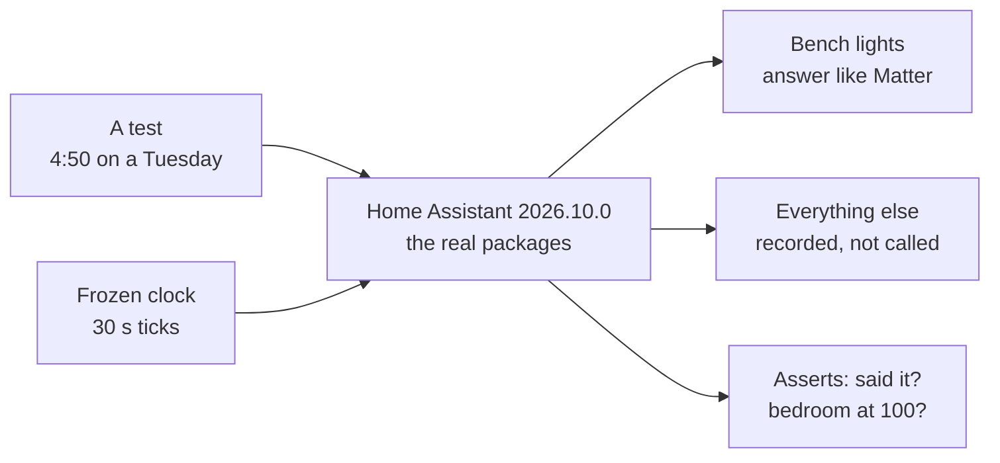

# Testing the house against a clock

*Level 2 to 3. Scenario tests on a real Home Assistant with a frozen clock, why they're built that
way, and what they've caught.*

The first real morning the alarm was supposed to run, it didn't. The automation that starts it
errored every minute from its first tick, because a time handed through a variable comes out as text
and you can't subtract text from a time, and a stray quote mark meant that even fixed, it would have
decided I was already up. Every test I'd done before that called the wake-up script directly. The
script was fine. The trigger was what broke, and nothing had ever pulled it.

There's a research line on exactly this. Ur and colleagues (CHI 2014) found trigger-action rules
easy to write and easy to get subtly wrong, and Brackenbury and colleagues (CHI 2019) sorted the
bugs people make into ten classes, with timing and "the trigger fired but a condition disagreed"
among the worst. So the tests here run the house the way it runs every day: its own packages, its
own triggers, a clock that moves forward minute by minute, and only the outside world faked.

## The bench



It runs on the Hub (`host/90-test-env.sh`): Home Assistant itself, the same version as the VM,
installed through `pytest-homeassistant-custom-component` 0.13.371 in its own Python 3.14, so the
template engine under test is the one that runs the house.

`tests/house.py` builds a house on it, a made-up one with its own rooms, lights and routine (an early
start, so a workday's wake time is 5:25 and the tests can name the minutes). Every package in
`ha/config/packages` loads as it is, with the custom templates and the helpers (input booleans,
selects, timers), and the areas, labels and the generated light lists are set up the way
`tools/setup_ha.py` sets them up from a `house.toml`, so the looks find their lights by layer and
job. The
lights are fakes that answer like Matter ones: a command changes the state inside the same tick and
carries the command's context, a person changing one carries none, and a colour light keeps its last
colour when it's only given a brightness, the way real colour lamps do. That difference is what the
by-hand detector keys on, so the fakes have to get it right. Everything else (notifications,
announcements, the vacuum, the TV) is recorded instead of called, so a test can ask "did it send
that to the phone?" or "did it say good morning?". And time only moves when a test says so, in 30-second ticks,
each one firing Home Assistant's time listeners the way a minute on the wall would.

One trap worth writing down. The obvious way to wait for the house to finish reacting is
`hass.async_block_till_done()`, and it deadlocks here: the wake-up sits in a one-minute delay that
only the next tick of the frozen clock can release, and the clock doesn't tick while the test is
waiting. So the bench lets things settle by yielding to the event loop a couple of hundred times
instead.

And one it fell into. The bench used to set a starting state for `binary_sensor.at_the_desk`, the
"At the desk" template, before the packages loaded. Home Assistant saw the name taken and gave the
real template `at_the_desk_2`, so every asleep and wake-up test read a desk that was always off,
and the bug that kept the house from noticing I was asleep ([sensing.md](sensing.md#asleep))
couldn't show up here. The bench leaves it alone now, and the night it broke is a test that fails
with the old 35 W line.

## What a test looks like

```python
async def test_walking_out_of_the_bedroom_stops_the_alarm(house_at):
    house = await house_at("2026-10-13 04:50", {"input_select.house_mode": "Night",
                                                "binary_sensor.bedroom_door": "off"})
    await house.advance(minutes=37)                      # 5:27, good morning said
    assert house.said("Good morning")
    house.forget()
    house.set("binary_sensor.bedroom_door", "on")
    await house.settle()
    assert house.attr("sensor.seen_up", "how") == "out of the bedroom"
    await house.advance(minutes=15)
    assert not house.said("Time to get up")
```

Nothing in it calls a script. It sets the world, moves the clock, and checks what the house did.

## Errors in the log fail the test

An automation that errors usually just looks like it did nothing, and a test that expects nothing
then passes. The by-hand detector did exactly that: it errored on every light without a brightness,
and its tests passed. So any error, failed condition or undefined template variable logged by the
house's own automations, scripts or templates fails the test now (`no_silent_errors` in
`tests/conftest.py`). A test that's meant to see an error, like the wake-up with a dead bedroom
light, says so with `@pytest.mark.expect_errors(...)`.

## What's covered

| File | Tests | What it pins down |
|---|---|---|
| `test_wake.py` | 9 | the wake-up from its real trigger, the backstop, a dead light, a broken plan, every way of saying you're up, the morning briefing written ahead and with no chores in it |
| `test_lights.py` | 21 | the gate, holds, by hand against by the house (a hand on a dimmer mid-fade too), the colour and brightness split, a no-dim kitchen left alone, a look never switching a task light on, the light curve through a day, nothing below 2700 K, Calm the hour before bed, blend steps too small to see, a lamp that restarted going straight back, a few more tries at a light that stayed on while you're out, an overhead standing in for a dead lamp, dark for a film |
| `test_asleep.py` | 10 | the filter: it takes a while, has memory, wakes for a real sign of life, not for a phone finishing its charge or a computer charging on the desk, and the bedroom radar over the desk plug |
| `test_blocks.py` | 5 | the control blocks alone: the Bayes step, hysteresis, the low-pass step response, PID with and without windup |
| `test_presence.py` | 31 | leaving and arriving, with and without the phone, a guest left behind, a lamp switched off from the app on the way out, every light off on the way out and how soon, Away picked by hand (and then out of the door), the car, the doorbell then the door, a door that opens late, the GPS alone not being home, a dead door sensor, the room lit before the door opens, the vacuum started on the way out, the welcome home (from the digest's kit and retired once heard, the old way with no kit, nothing written from it or no Hub address) and the floor lamp's colour coming in |
| `test_doors.py` | 10 | the vacuum and shut doors, the bathroom, the bedroom door in the morning, on the way home |
| `test_reminders.py` | 2 | reminders go off on time, in order |
| `test_digest.py` | 13 | the digest on its own: nothing said twice, a kit nobody heard retiring nothing, a repo only ever what's new since last time, the same story from a fork, a forum post and a write-up a week later, the way of telling it never one of the last two, shelves taking turns, late being one thing, old news dropping out, feeds coming in clean, chores and help requests left out |
| `test_smoke.py` | 1 | everything loads |

102 in all, about six minutes on the Hub. The PID test is the closest thing here to hardware in the
loop: it closes the loop around a simulated room (first order, two-minute time constant) and checks
it settles with no offset and doesn't wind up, so the block is known to work before anything real
depends on it.

## Running it before every deploy

`tools/ha-apps.sh` runs the whole bench before anything gets copied to Home Assistant, and stops
if anything fails (`SKIP_TESTS=1` gets past it, for when the bench itself is the problem).
`tools/test.sh` runs it on its own and passes arguments through:

```bash
tools/test.sh -k wake -x
```

Writing the first batch found four real problems before anything shipped, including the alarm's own
sunrise blocking itself in the arbiter and the clock-started hole in the by-hand detector. The check
I cared about most: put the original alarm bug back, and the morning test fails straight away.

The bench doesn't run on Windows or macOS, because Home Assistant itself doesn't, which is why it
lives on the Hub. If you'd rather not give it the 900 MB, skip `host/90-test-env.sh` and deploy with
`SKIP_TESTS=1`; the house runs the same either way, you just lose the net under changes to the
packages.

## What I'd like to build next

- Replaying real days: Home Assistant's recorder has every state change, so a day could be fed back
  through the bench and the new logic's decisions compared with what actually happened
- The voice path in the same harness. Today it's tested by replaying saved turns through the models
  ([voice.md](voice.md)), which covers the math but not the satellite's protocol, and both voice bugs
  so far were protocol bugs

## References

- [Ur et al., practical trigger-action programming in the smart home (CHI 2014)](https://www.springerprofessional.de/doi/10.1145/2556288.2557420): rules are easy to write and easy to get wrong
- [Brackenbury et al., how users interpret bugs in trigger-action programming (CHI 2019)](https://par.nsf.gov/biblio/10106413): ten classes of rule bugs, timing among the worst
- [pytest-homeassistant-custom-component](https://github.com/MatthewFlamm/pytest-homeassistant-custom-component): Home Assistant's own test harness, packaged

Next: [what broke along the way](lessons.md), the long list.
