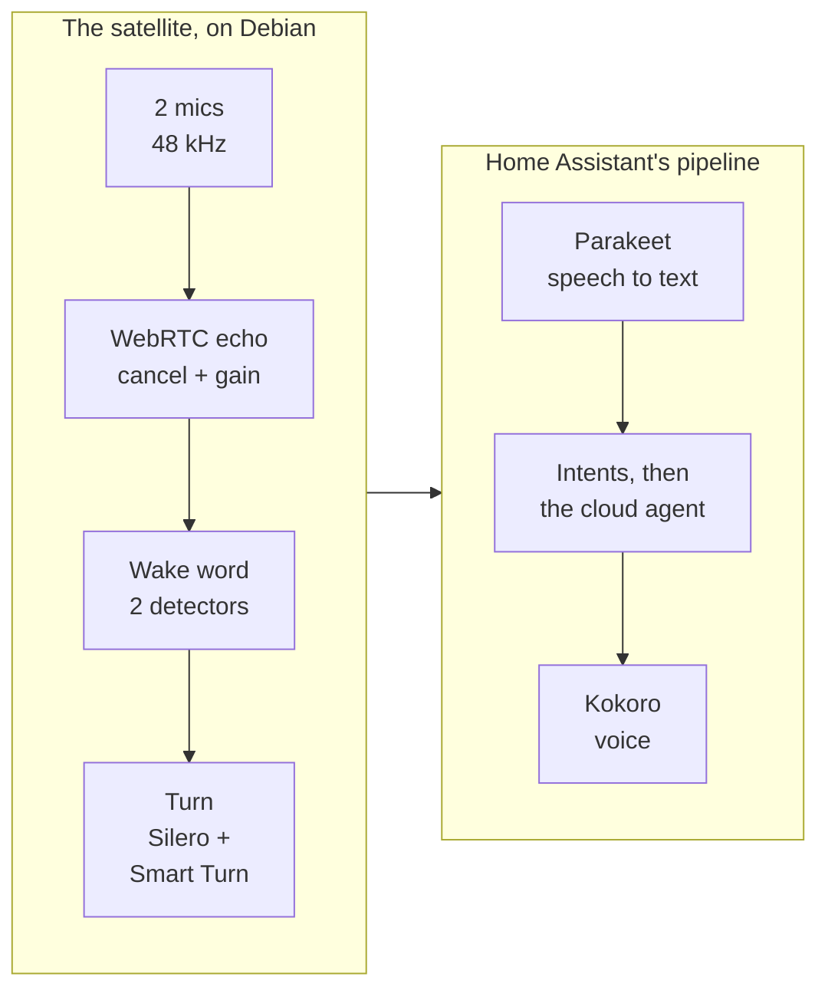
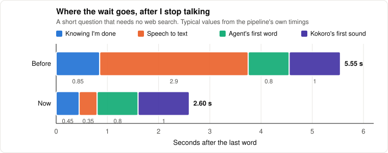
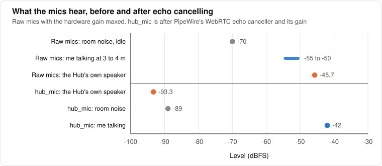
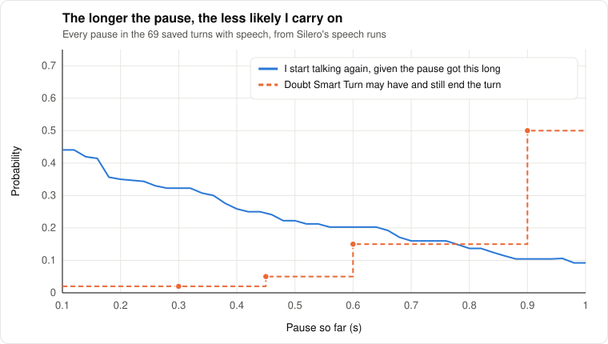
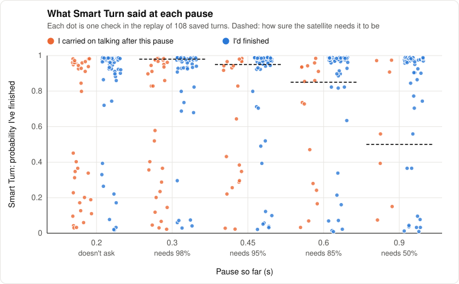
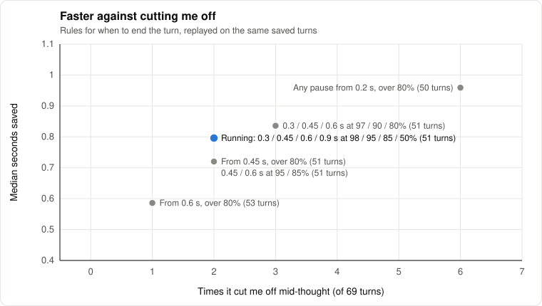
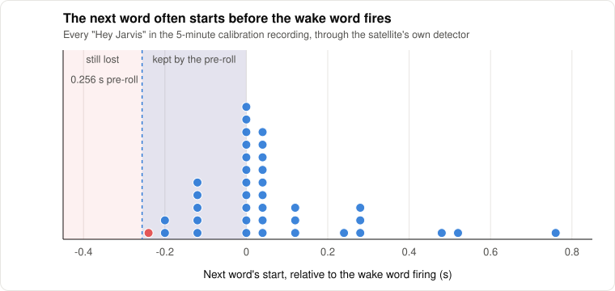
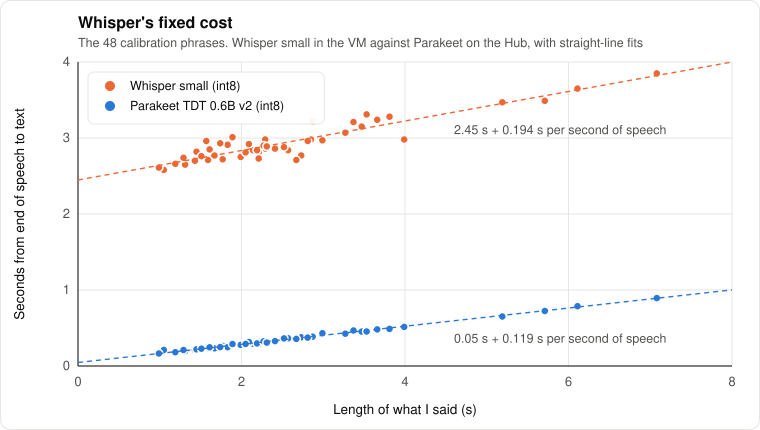
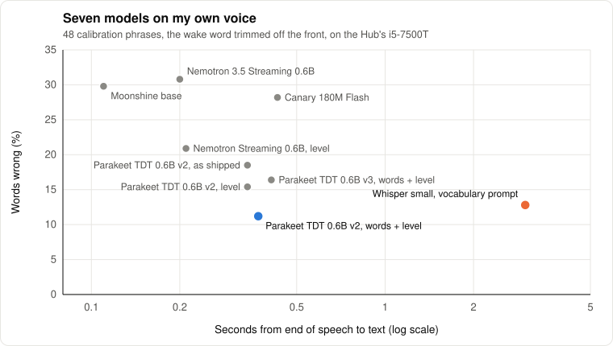
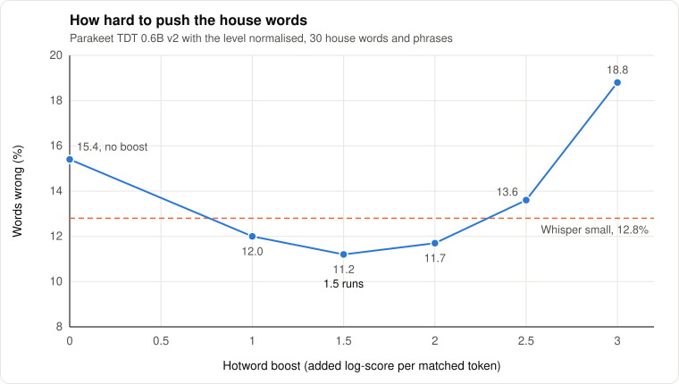

# How Jarvis listens and answers

*Level 4. The whole voice path, measured: where the time goes, why Whisper was slow, how the
replacement was picked, and how the satellite now hears a sentence end. All the way into the math.*

Out of the box, asking Jarvis something it had to think about meant about six seconds of silence
after I'd finished the sentence. Long enough to wonder whether it heard. My first guess was the
cloud, since the answer comes from an agent in a data centre, and I wanted to fire the request off
while I was still talking. That guess was wrong, and finding out why turned into rebuilding two of
the four stages and the front of the pipeline. Now it's about 2.6 s, and most of what's left is the
agent thinking.

This page goes in the order the audio does: the mics, the wake word, the turn, speech to text, the
agent, the voice. Every number came off my Hub, with my voice, through the real pipeline, so treat
them as one box and one speaker rather than a benchmark. Yours will land somewhere near.

## From the mics to the speaker



The first four run on the Hub's Debian side (PipeWire, then the patched Linux Voice Assistant
satellite), speech to text and the voice are Wyoming servers on the Hub too, and the middle is Home
Assistant's Assist pipeline in the VM. The satellite talks to Home Assistant over the ESPHome API, which matters
later, because that protocol is where two of the bugs were.

What I care about is the time from my last word to Jarvis's first sound. It's a sum of four stages,
each waiting on the one before it:

```math
T = T_{\text{end}} + T_{\text{stt}} + T_{\text{agent}} + T_{\text{tts}}
```



*Speech to text was more than half of it. The agent was never the problem.*

Timed with `assist_pipeline/run` over the websocket, feeding recorded questions at real-time pace.
The agent's first word is 0.65 to 1.0 s with prompt caching on, and a warm connection only takes
another 0.35 s off that, so firing the request early would have saved almost nothing. The answer
was in the two stages I'd assumed were fine.

## The mics and the echo

The Hub was sold as a conference speakerphone, so I expected echo cancellation in hardware. There
isn't any on the USB stream: white noise at -20 dBFS out of the speakers lands on the mics at
-44.5 dBFS and stays there, no adaptation. PipeWire's WebRTC canceller does it in software instead,
and it gets an easy job, because the speakers and the mics share one USB clock. No drift between the
reference and the capture, which is the thing that usually kills software echo cancelling.



*The Hub's own voice drops by about 47 dB. That's what lets the wake word listen while Jarvis talks.*

The mics are quiet, though. Speech from across the room peaks 15 to 20 dB over the floor with the
hardware gain already maxed, so the canceller's digital gain carries a lot. That quietness comes
back later: it's why Parakeet needed help that Whisper didn't.

## Two wake word detectors

"Hey Jarvis" goes through two detectors at once and either one wakes it. microWakeWord's stock
model steps every 10 ms and averages the last five probabilities against a cutoff (0.90 here,
0.97 stock), and openWakeWord's "hey jarvis" runs beside it at 0.5. If their misses were
independent, the chance of both missing would be the product:

```math
P(\text{miss}) = P(\text{miss}_1)\,P(\text{miss}_2)
```

They aren't independent (quiet or mumbled ones are hard for both), but they're independent enough
to matter. On the calibration session (53 times "Hey Jarvis", walking around the room), microWakeWord
alone at 0.97 caught 38. With openWakeWord at 0.30 the pair caught 50. I had to give some of that
back once there were guests talking in the room, because openWakeWord at 0.30 fired on speech with
no "Jarvis" in it, so it's at its default 0.5 now, which costs 3 of the calibration wakes. Recall against false wakes is
the usual trade, and a false wake in a room with a guest costs more than a repeat.

### The stop word

While Jarvis talks, the satellite also listens for "stop", with microWakeWord's stock stop model.
Nice idea, blunt model. I ran it over 232 saved requests and it fired in 14, on "Spotify", "Help",
"Where am I?" and a plain "So", with no "stop" in any of them. And its averaged score tops out at
0.81, which is also exactly what a clean "stop" gets, so no cutoff keeps the real one and drops the
rest.

I'm fairly sure that's what kept cutting the welcome home off after its first sentence. Replayed
with the speaker at zero it played to the end every time, even with Kokoro frozen halfway, and the
stop word was the one thing that could end it without leaving a line in the log. The satellite
then reported the announcement finished, so the house counted it as heard.

So announcements don't listen for it any more (`host/patches/lva-announce.patch`). Answers and a
ringing timer still do, since I asked for those. "Hey Jarvis, stop" (or "be quiet") ends an
announcement without a word, and the satellite tells Home Assistant it's over instead of leaving it
waiting five minutes. Every stop it hears while Jarvis is talking goes in the journal now, the
ones an announcement lets go included, so the next few welcomes will show whether this really was
what cut them off.

## Knowing when I've finished

### The fixed timer

Home Assistant decides I'm done after a fixed stretch of silence: 0.7 s by default, 1.25 s on
"relaxed", 0.25 s on "aggressive" (`assist_pipeline/vad.py`). One number for every sentence. Too
long after "turn off the lamp", and too short when I stop to remember a name. In the turns Home
Assistant had saved, the default cut me off twice ("it looks like she's at, um").

A person hears a sentence end: the pitch drops, the grammar closes. So the satellite now listens
for that itself, with two small models running on the mic stream while it streams to Home Assistant
(`hub/lva_end_of_turn.py`, `host/patches/lva-endofturn.patch`).

### Silero finds the pauses

[Silero VAD](https://github.com/snakers4/silero-vad) (v6.2.3, 2.3 MB ONNX) gives a speech probability for every
32 ms frame (512 samples), carrying its own recurrent state and 64 samples of context between
frames. A frame counts as speech above 0.5, and a run of four in a row (128 ms) counts as me
talking, so a cough or a door click doesn't reset anything. Every frame that isn't speech adds
32 ms to the current pause $`\tau`$.

### Smart Turn hears the sentence

[Smart Turn v3.2](https://github.com/pipecat-ai/smart-turn) (BSD 2-clause, 8.7 MB int8) is a Whisper Tiny encoder with a
linear head: about 8M parameters that hear the last 8 s of audio and say how likely it is the
speaker has finished. It was trained on audio, not text, so the intonation counts as much as the
words.

The input has to be exactly what it was trained on, and the reference code gets it from the
`transformers` library, which is far too big to put in the satellite. So the satellite builds the
features itself in numpy. Take the last 8 s, left-padded with zeros to $`N = 128\,000`$ samples, and
normalise it:

```math
\hat x[n] = \frac{x[n] - \mu}{\sqrt{\sigma^2 + 10^{-7}}}
```

then a short-time Fourier transform with a 25 ms Hann window ($`L = 400`$) every 10 ms
($`H = 160`$), reflect-padded by 200 samples at each end:

```math
X_m[k] = \sum_{n=0}^{L-1} \hat x[mH + n - 200]\; w[n]\; e^{-j 2\pi k n / L},
\qquad w[n] = \tfrac{1}{2}\left(1 - \cos\frac{2\pi n}{L}\right)
```

The power spectrum goes through Whisper's 80-band Slaney mel filterbank $`\mathbf{M}`$ (80 by 201),
then a log with Whisper's clamp to 8 decades under the loudest bin, then a scale:

```math
E = \mathbf{M}\,\lvert X \rvert^2, \qquad
\ell = \max\!\bigl(\log_{10}\max(E, 10^{-10}),\; \max\log_{10} E - 8\bigr), \qquad
F = \frac{\ell + 4}{4}
```

That's an 80 by 800 matrix (the last of the 801 frames is dropped), and the model's output goes
through a sigmoid, $`p = \sigma(z)`$. Checked against `transformers.WhisperFeatureExtractor` on real
turns, the largest difference was $`1.2 \times 10^{-7}`$ and the probabilities matched to four
decimals. One check takes about 0.1 s on one core, so it runs on its own thread and the mic, and the
wake word with it, never waits.

### When to believe it

At set points in a pause the satellite asks Smart Turn, and ends the turn if it's sure enough for
how long the pause has lasted:

```math
\text{end at } \tau_k \iff p(\tau_k) > \theta_k, \qquad
(\tau_k, \theta_k) \in \{(0.3, 0.98),\ (0.45, 0.95),\ (0.6, 0.85),\ (0.9, 0.5)\}
```

If none of them fire, Home Assistant's own timer, now on relaxed, ends the turn at 1.25 s. Smart Turn
can only make a turn shorter, never longer than the fallback.

Why a schedule and not one threshold? Because the base rate moves under it. Every pause in the saved
turns, from Silero's speech runs: right after I stop, a pause is followed by more speech 44% of the
time. By 0.9 s it's about 10%.



*The longer the pause, the less the model has to prove.*

**My reading of it (theory).** Write Smart Turn's answer as odds and update them with how often
pauses that long turn out to be the end, $`\pi(\tau) = P(\text{finished} \mid \text{pause} \ge \tau)`$:

```math
\frac{P(\text{finished} \mid \text{audio}, \tau)}{P(\text{more} \mid \text{audio}, \tau)}
\approx \frac{p}{1-p} \cdot \frac{\pi(\tau)/\bigl(1-\pi(\tau)\bigr)}{\pi_0/(1-\pi_0)}
```

where $`\pi_0`$ is whatever base rate the model was trained around. As $`\pi(\tau)`$ climbs, the same
$`p`$ means more, so the bar on $`p`$ can drop. It isn't exact, because Smart Turn hears the silence
at the end of its window too and already knows some of $`\tau`$. The actual numbers came from the
replay below, not from this formula. The formula is why their shape made sense to me.

### The replay

Home Assistant had saved 108 turns of me talking to it (69 with speech, the rest follow-up windows
where nobody said anything). I ran each one through Silero and Smart Turn exactly as the satellite
would, asking at every pause, then read the transcripts of the cases where speech followed the
point it would have ended.



*Most of the time it's sure and right. The orange dots up near 1 are the ones that hurt.*

Some of those orange dots were good news: five stretches of side conversation (two people talking
with Jarvis still listening), where ending early is exactly right. The rest were real cut-offs, a
sentence stopped mid-thought with "...going to have a" and the rest of it still to come. So each rule I tried got two scores, how much sooner it ended the
turns it got right and how often it cut me off:



*Asking at every pause is fastest and rude. The schedule keeps most of the speed.*

The running schedule ends 51 of the 69 turns early, a median 0.80 s sooner than the old timer, and
cut me off twice. About one turn in six it never gets sure, and those now wait the full 1.25 s, 0.55 s
longer than before. Probably fewer in practice, because the saved turns stop at about 1 s of
silence and the 0.9 s check rarely got its chance. All 108 turns are my voice, in one room, mostly
short questions. I'd expect the numbers to move once there's a week of real use, which is
why every check goes in the journal:

```bash
journalctl --user -u linux-voice-assistant | grep "end of turn"
```

`LVA_TURN_CHECKS` changes the schedule without touching the code, and an empty `LVA_END_OF_TURN`
turns the whole thing off.

### Two protocol bugs

The first live try ended every turn beautifully and got no answer at all. The satellite was ending
the turn with `VoiceAssistantRequest(start=False)`, the message the satellite's own 15-second
listening cap uses, and to Home Assistant that's abort: drop the audio, no transcript, no answer.
The normal way to say "that's all I said" is the last audio message with `end=True`, which
`aioesphomeapi` turns into a stop instead of an abort. One line.

The second showed up as Jarvis mishearing "who am I" as "where am I", and once hearing nothing at
all. The saved audio said why: the clipped turns were loud right at 0 s, the start of the sentence
missing. Two things were eating it.

Home Assistant clears its audio queue when a run starts (`handle_pipeline_start`), and the satellite
used to stream from the instant the wake word fired, so whatever arrived before Home Assistant was
ready went in the bin. And said in one breath, the next word can start before the wake word fires.
I replayed the satellite's own detector over the 5-minute calibration recording and lined each
firing up against Parakeet's word timings: it fires a median 0.02 s after "Jarvis" ends, but the
next word starts up to 0.26 s before it fires.



*Without a pre-roll, everything left of zero is gone before the turn starts.*

The fix (`host/patches/lva-preroll.patch`) keeps the last $`R`$ seconds of mic in a ring buffer.
Once woken, the satellite holds the audio until Home Assistant reports the speech-to-text stage
started (`STT_START`, with a 2 s fallback), then sends the buffer and everything since in one go.
The mic arrives in 1024-sample blocks, so the pre-roll is whole blocks:
$`R = \lfloor 0.3 / 0.064 \rfloor \times 0.064 = 0.256`$ s. That covers 37 of the 38 onsets I could time,
and sometimes catches the tail of "Jarvis" too, so Parakeet's server strips a leading "Jarvis" or
"vis" off the transcript.

## Speech to text

### Why Whisper was slow

Home Assistant does stream the audio while I talk. Every chunk goes to the speech-to-text server as
it arrives. Whisper can't use it until the end, because it's built around a fixed 30-second window:
the log-mel input is always 3000 frames, downsampled to 1500 encoder positions, and the encoder runs
over all of them whether I said two words or twenty. Then the decoder adds a cost per token. So the
time after I stop is a fixed cost plus a slope in $`d`$, the seconds of speech:

```math
T_{\text{stt}} \approx a + b\,d
```



*The intercept is the 30 s window, paid every time. Parakeet's line starts near zero.*

On my 48 calibration phrases, Whisper small (int8, in the VM, through the REST API) came out at
$`a = 2.45`$ s and $`b = 0.19`$ s per second of speech. The intercept is the encoder chewing through
the padding. "Streaming Whisper" projects ([Whisper-Streaming's LocalAgreement](https://alphaxiv.org/abs/2307.14743),
WhisperLive) re-run it on the growing audio and commit the words two passes agree on, which is
clever and hopeless here: one pass already costs more than the audio it covers.

### What replaced it

Transducer models are a different shape. The encoder (a FastConformer here, 8 times subsampling, so
one position per 80 ms) is the size of the audio, and the decoder walks it emitting a token or
moving on. The probability of a transcript $`y`$ is a sum over every alignment $`a`$ of it to the
frames:

```math
P(y \mid x) = \sum_{a \in \mathcal{B}^{-1}(y)} \prod_{i} P(a_i \mid x, a_{\lt i})
```

NVIDIA's TDT ("token and duration") variant predicts how many frames to skip along with each
token, which is a big part of why decoding is cheap. Cost scales with the audio, not with a
window. Through [sherpa-onnx](https://github.com/k2-fsa/sherpa-onnx) on the Hub's i5-7500T, Parakeet TDT 0.6B v2 (int8)
decodes at about 0.12 times real time.

### The bake-off

Seven local models through sherpa-onnx, against 48 phrases I recorded walking around the room,
with "Hey Jarvis" cut off the front the way the pipeline never sends it. Accuracy
is word error rate, the edit distance between what I said and what came out, in words:

```math
\text{WER} = \frac{S + D + I}{N}
```

substitutions, deletions and insertions over the words in the reference. Before scoring, both sides
are lowercased, punctuation goes, and a few spellings that change nothing for the agent are made
equal ("T V" and "TV", "gonna" and "going to").



*Out of the box, every one of them lost to Whisper. Two changes turned Parakeet around.*

| Model | Words wrong | Exactly right | After I stop | Compute |
|---|---|---|---|---|
| Whisper small, house vocabulary prompt | 12.8% | 24 of 48 | 3.0 s | |
| **Parakeet TDT 0.6B v2, house words, level up** | **11.2%** | **29 of 48** | **0.37 s** | 0.14x real time |
| Parakeet TDT 0.6B v2, level up | 15.4% | 26 | 0.34 s | 0.12x |
| Parakeet TDT 0.6B v2, as shipped | 18.5% | 21 | 0.34 s | 0.12x |
| Parakeet TDT 0.6B v3, house words, level up | 16.4% | 22 | 0.41 s | 0.15x |
| Nemotron Speech Streaming 0.6B (560 ms), level up | 20.9% | 17 | 0.21 s | 0.35x |
| Canary 180M Flash | 28.2% | 15 | 0.43 s | 0.16x |
| Moonshine base | 29.8% | 15 | 0.11 s | 0.04x |
| Nemotron 3.5 Streaming 0.6B | 30.8% | 9 | 0.20 s | 0.33x |

Parakeet's "unified" streaming model never finished: 14 minutes in, it hadn't got through the
2.7 minutes of audio.

### Turning the level up

My voice peaks around -42 dBFS from across the room. Whisper shrugs that off and Parakeet doesn't,
so each clip gets normalised to a -6 dBFS peak before decoding,
$`\hat a = a \cdot 0.5 / \max_n \lvert a[n] \rvert`$, which took Parakeet from 18.5% to 15.4% on its
own. I'd half expected nothing, since as far as I know the model normalises its features anyway. My
guess (theory) is the log floor: quiet speech sits close to the small constant added before the
log, so the quiet consonants get flattened into it before any normalising happens.

### Boosting the house words

Whisper had the house's own words in its prompt: brand names, the printer's name, the people I
talk about. A transducer has no prompt, but its beam
search can be biased. sherpa-onnx compiles a list of phrases into a matching graph over the model's
own word pieces, and a hypothesis that extends a match gets a bonus $`\beta`$ added to its log score
for each matched piece, taken back if the phrase doesn't complete. So the beam ranks hypotheses by

```math
s(y) = \log P(y \mid x) + \beta \sum_{t} c_t(y)
```

with $`c_t(y)`$ one for each piece that continues a phrase in the list. It only works with modified
beam search (the streaming NeMo models in sherpa-onnx only do greedy, which is the other reason they
were out). One catch: sherpa needs a sentencepiece-style vocabulary to split the phrases, and the
NeMo exports don't ship one. Their `tokens.txt` is in merge order, so a vocabulary with score
$`-\text{id}`$ for each piece rebuilds it, which the server does at start-up.



*Push too hard and it starts hearing house words that aren't there.*

The list is `hub/parakeet-words.txt` plus your own `hub/parakeet-words.local.txt`, thirty or so words
and phrases on mine, and 1.5 is the bottom of the curve.
One honest caveat: the boost and the level were tuned on the same 48 clips they're scored on, so
11.2% is probably a bit optimistic. Whisper's prompt was picked on those clips too, so at least it's
the same optimism on both sides.

### Streaming would have been more elegant

The streaming models emit text while I talk, which is what I set out to build. But Parakeet decodes
3 s of speech in about 0.4 s after the end, so there's very little left to overlap, and it's
miles more accurate than the streaming ones here. If a full decode cost seconds, streaming would
win. It doesn't. The server is `hub/parakeet_wyoming.py` (`host/76-parakeet.sh`, about 830 MB of
memory), and Whisper stays installed in the VM as the fallback: `tools/setup_ha.py` picks it if
`stt.parakeet` isn't there.

## The agent

Two layers. Home Assistant's own sentences go first ("prefer local intents"): anything that matches
one exactly, like "turn off the lamp" or "who am I", is answered in milliseconds without leaving the
house. Everything else goes to the cloud agent, `conversation.jarvis_cloud`, which is whichever
provider's conversation integration you added (`voice.cloud_agent` in `house.toml`), with
`ha/context/about.md` and your `about.local.md` as its prompt. On mine that's one of the big hosted
models with low reasoning effort, prompt caching on and up to two web searches a question. A
smaller, faster model from the same provider was cheaper and quicker, and kept gluing search-result
headlines onto its answers whatever the prompt said, so speed per question isn't the only thing to
compare.

Its time to the first word is 0.65 to 1.0 s on a plain question. Questions that need a search or a
long answer take 3 to 6 s, and that's now the biggest piece left on those. The prompt asks for
speech, not text: lead with the answer, contractions, short sentences, no parentheses, numbers
the way they're said. A reply that reads well and sounds stiff is still a bad reply.

## The voice

Kokoro (82M parameters, the int8 ONNX model) runs at about twice real time on the Hub's CPU, through
a Wyoming bridge (`hub/kokoro_wyoming.py`). Home Assistant streams the agent's reply as it's written,
and the bridge speaks it sentence by sentence, so the first sound depends only on the first piece:

```math
T_{\text{tts}} \approx \frac{D_1}{r}
```

where $`D_1`$ is how long the first piece takes to say and $`r \approx 2`$ the synthesis speed. To
shrink $`D_1`$, the bridge speaks the first clause on its own when the first sentence is long. That
used to cut lists in half: "Genius, billionaire, playboy, philanthropist" came out as two halves
with a gap in the middle. It only splits off a real clause now, four words or more, and never
a sentence with three or more commas in it.

## What I'd like to build next

### Starting the agent early

The idea I started with, done properly: send the half-finished sentence to the agent while I'm still
talking, and throw it away if I keep going. LiveKit calls it
[preemptive generation](https://docs.livekit.io/agents/logic/turns/tuning.md), Deepgram an
[eager end of turn](https://developers.deepgram.com/docs/flux/voice-agent-eager-eot). The saving is
bounded by how much of the agent's time can overlap the end of my sentence:

```math
E[\Delta T] \approx P(\text{guess holds}) \cdot \min\bigl(T_{\text{agent}},\ T_{\text{end}}\bigr)
```

and with Smart Turn ending most turns in 0.3 to 0.45 s, that's a few tenths of a second for a lot
more calls (Deepgram puts it at 50 to 70% more), and any light it would switch has to wait for the
confirmed sentence anyway. Home Assistant is adding partial transcripts to speech to text right now
([home-assistant/core#184336](https://github.com/home-assistant/core/pull/184336)), and that's what
it would be built on. I'd rather wait for it than patch around it.

### Tuning on a week of real turns

The schedule came from 108 saved turns of one voice. A week of live ones, with every check in the journal, will
say whether 98% at 0.3 s is too strict for short questions (it hesitated on a clear "who am I?" at
95%). And if the two wake word detectors still miss more than one in twenty after that, a model
trained on my own voice is next.

## Rerunning the numbers

The recordings stay on my own machines, outside the repo, because they're my voice in my home. What the benches printed is in
[`figures/data.json`](figures/data.json), and every chart on this page is drawn from it by
[`figures/make_figures.py`](figures/make_figures.py) (standard library Python, rerun it after
changing a number). The benches themselves were short sherpa-onnx scripts on the Hub: decode each
clip, time it, score it with the edit distance above.

## References

- [Smart Turn](https://github.com/pipecat-ai/smart-turn) and its [v3 weights](https://huggingface.co/pipecat-ai/smart-turn-v3): audio-only end of turn on a Whisper Tiny encoder
- [Silero VAD](https://github.com/snakers4/silero-vad): the frame-level speech detector under it
- [sherpa-onnx](https://github.com/k2-fsa/sherpa-onnx): the runtime for every model in the bake-off, and the hotword biasing
- [Parakeet TDT 0.6B v2](https://huggingface.co/nvidia/parakeet-tdt-0.6b-v2): the model now running
- [Xu et al., Efficient sequence transduction by jointly predicting tokens and durations (2023)](https://arxiv.org/abs/2304.06795): the TDT idea
- [Graves, Sequence transduction with recurrent neural networks (2012)](https://arxiv.org/abs/1211.3711): the transducer and its sum over alignments
- [Radford et al., Whisper (2022)](https://arxiv.org/abs/2212.04356): the 30-second window
- [Macháček et al., Turning Whisper into a real-time transcription system (2023)](https://alphaxiv.org/abs/2307.14743): LocalAgreement, and why it needs a fast pass
- [Moonshine v2 (2026)](https://arxiv.org/abs/2602.12241): streaming encoders with bounded latency, the most interesting of the ones that lost here
- [Linux Voice Assistant](https://github.com/OHF-Voice/linux-voice-assistant): the satellite, and [the Wyoming protocol](https://github.com/OHF-Voice/wyoming) that the speech engines speak
- [LiveKit turn tuning](https://docs.livekit.io/agents/logic/turns/tuning.md) and [Deepgram eager end of turn](https://developers.deepgram.com/docs/flux/voice-agent-eager-eot): speculative generation, the next step
- [home-assistant/core#184336](https://github.com/home-assistant/core/pull/184336): partial transcripts in Home Assistant

Next: [how the house decides](control.md), the other half of the brain.
